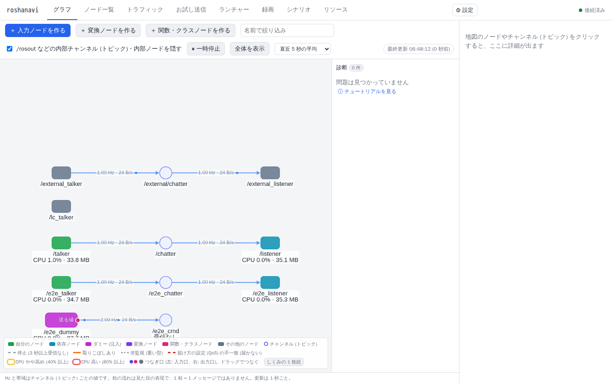
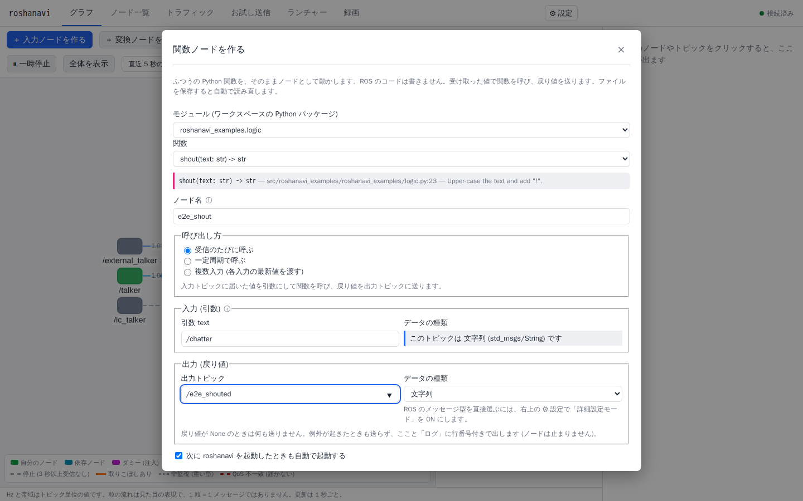

# roshanavi

**ROS 2 のノード開発を、ブラウザひとつで。** ROS をよく知らない人でも、ノードを起動し、入力を流し、出力と通信の様子を見て、テストまでできる開発ツールです。

対応: **ROS 2 Jazzy・Lyrical Luth** に正式対応。Kilted Kaiju は動作確認のみ (継続的な保証なし) です。

名前は「ROS + 花火 (launch = 打ち上げ)」と「ナビ (案内役)」から。既定のポート 6871 も ro(6)s-ha(8)-na(7)-bi(1)。



## なぜ作ったか

ROS 2 の確認・テストの道具 (`ros2 topic hz/echo/pub`、rqt_graph、rqt_publisher、launch_testing、rosbag …) は便利ですが、ばらばらで、それぞれの使い方と組み合わせ方を知っている前提です。roshanavi はそれらを 1 つの画面にまとめ、ROS に詳しくない開発者がつまずく所 (QoS の不一致、受信側がいない、トピック名の打ち間違い …) をツール側から指摘します。

## できること

| 機能 | 内容 |
|---|---|
| ライブ通信マップ | ノードとトピックのつながりを、通信の流れのアニメーション付きでリアルタイム表示。QoS 不一致・相手不在・似た名前などを診断 |
| トラフィック | ノード × トピック × 向きごとの Hz・帯域・取りこぼし・遅延。C++ 計測ノードで送信元ごとに実測 |
| 詳細計測モード | ROS 2 組み込みのトレース (LTTng) で、受信数・処理数・コールバックの処理時間を実測。ソースの変更は不要 |
| ランチャー | 自分のノードと依存ノードの起動・停止・ログ・ビルド。既存の launch ファイルを分解して取り込み、ノード一覧で一括 ON/OFF |
| 入力ノード | 文字列・数値・画像・動画・音声・ブラウザのマイク/カメラを、常駐するダミーノードとして送る |
| 変換ノード | 「トピック A を受けて B に出す」ノードを、式を書くだけで作る (未完成のノードの代役にも) |
| 関数ノード | 普通の Python 関数を、そのまま ROS ノードとして動かす |
| 録画・再生 | bag に録って、次から同じ入力で再現 |
| シナリオ | 「入力したら、○秒以内にこう出る」を記録して、UI と CLI で自動判定 |
| リソース監視 | ノードごとの CPU・メモリ (地図にバッジ)、PC 全体の CPU・メモリ・ディスク・ネットワーク・GPU、外部との接続先、メモリリークの疑いと UDP 受信バッファ溢れの診断 (この PC のみ) |
| チュートリアル | 画面の見方・入力ノード・QoS の直し方・関数ノード・シナリオを、画面上で操作を案内しながら学べる (⚙ 設定からいつでも) |



MVP の対象はトピックのみです。**サービス・アクションへの対応は今後予定しています。**

## 試す (Docker)

ホストに ROS は不要です。Docker と Docker Compose があれば動きます。

```bash
git clone https://github.com/shimejilib/roshanavi.git
```

```bash
cd roshanavi && docker compose up -d --build lab demo
```

ブラウザで http://localhost:6871 を開きます。デモの talker / listener (roshanavi から起動したノード) と、外部ノードの例が表示されます。⚙ 設定 →「プロジェクトを切り替える」から、画像処理のデモ (perception_demo) と、rclpy の MultiThreadedExecutor が CPU を空回りする様子を確かめるデモ (busy_demo) も開けます。

自分のワークスペースで使う手順は [docs/project/distribution.md](docs/project/distribution.md) を参照してください (ソースからのインストール。将来は apt で配布予定)。

## ドキュメント

| ドキュメント | 内容 |
|---|---|
| **まず読むもの** | |
| [docs/overview/vision.md](docs/overview/vision.md) | 出発点、対象ユーザー、ノード開発者の利用の流れ、ゴールと非ゴール |
| [docs/overview/architecture.md](docs/overview/architecture.md) | 技術選定、リポジトリ構成、全体の仕組み |
| [docs/overview/roadmap.md](docs/overview/roadmap.md) | フェーズと進み具合 |
| **機能ごとの設計 (実装済み)** | |
| [docs/design/map-and-traffic.md](docs/design/map-and-traffic.md) | 通信マップ、トラフィック、診断 |
| [docs/design/measurement.md](docs/design/measurement.md) | C++ 計測ノード、詳細計測 (トレース)、ベンチマーク結果 |
| [docs/design/input-and-media.md](docs/design/input-and-media.md) | お試し送信、メディア注入、ブラウザ取り込み、録画 |
| [docs/design/nodes.md](docs/design/nodes.md) | 入力ノード、変換ノード、関数ノード、データの種類 |
| [docs/design/launcher.md](docs/design/launcher.md) | ランチャー、プロジェクトファイル、パラメータ、lifecycle、launch の取り込み |
| [docs/design/ui.md](docs/design/ui.md) | 画面構成、右クリックメニュー、ノード一覧 |
| [docs/design/api.md](docs/design/api.md) | REST / WebSocket API |
| [docs/design/security.md](docs/design/security.md) | 安全対策 (式評価、パス検査、サブプロセス、launch のサンドボックス、Host/Origin 検査) |
| [docs/design/scenarios.md](docs/design/scenarios.md) | シナリオと記録モード |
| [docs/design/resources.md](docs/design/resources.md) | リソース監視 (CPU・GPU・メモリ・ディスク・ネットワーク)、メモリリーク検出 |
| **設計済み・未実装** | |
| [docs/planned/remote-access.md](docs/planned/remote-access.md) | 別マシンからのアクセス (デバイスのペアリングと権限) |
| **開発・運用** | |
| [docs/project/testing.md](docs/project/testing.md) | テスト方針、テストの実行方法、テスト項目一覧 |
| [docs/project/dependencies.md](docs/project/dependencies.md) | 依存関係 (用途・ライセンス・rosdep キー) |
| [docs/project/distribution.md](docs/project/distribution.md) | 配布形態とインストール |

docs 全体の案内は [docs/README.md](docs/README.md) にもあります。既知の課題と今後の予定は GitHub Issues で管理しています。

## 開発

```bash
docker compose --profile test run --rm test
```

```bash
cd web && npm ci && npx vitest run
```

```bash
scripts/e2e.sh
```

それぞれ、バックエンドのテスト (gtest + pytest)、Web UI の単体テスト、E2E (専用の環境で実行し、手元の lab には触れない) です。詳しくは [docs/project/testing.md](docs/project/testing.md)。

## ライセンス

[MIT](LICENSE)
