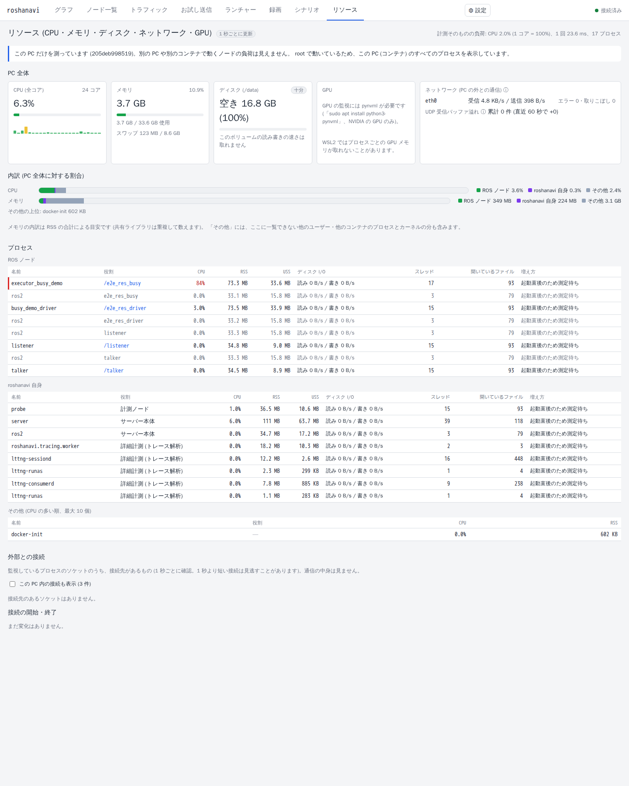
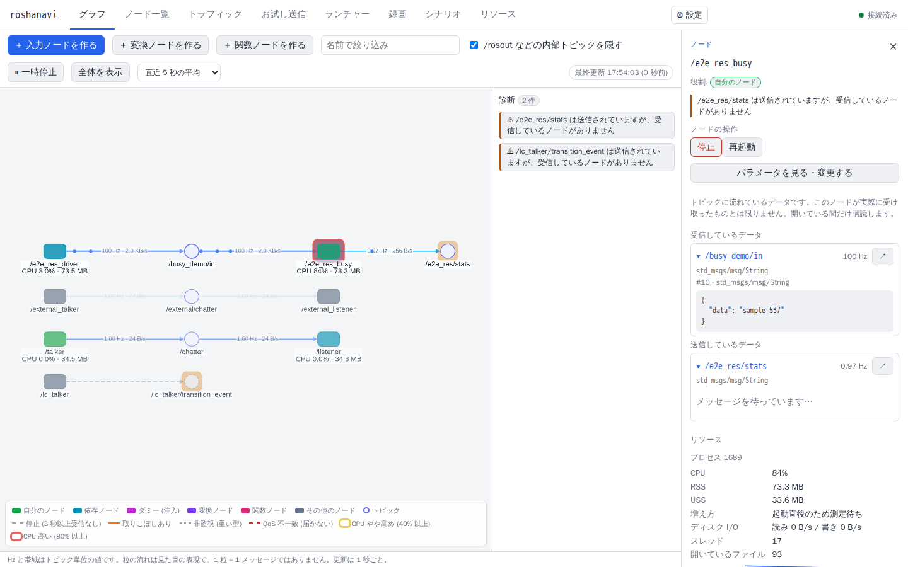

# roshanavi — リソース監視 (CPU・メモリ・ディスク・ネットワーク・GPU)

ノードがどれだけ CPU・メモリ・ディスク・ネットワーク・GPU を使っているかを、同じ PC の中で 1 秒ごとに測り、地図・右ペイン・「リソース」タブ・診断パネル・シナリオで見せる (Lv1, #32)。複数の PC・コンテナをまとめて見る Lv2 は将来の課題 ([将来 (Lv2)](#将来-lv2-複数-pc複数コンテナ))。実装は `roshanavi/resources/`、API は `server_resources.py`、画面は `web/src/resources/` と `web/src/detail/NodeResources.tsx`。

## 前提: ノードとプロセスの対応づけ
ROS 2 のグラフ情報には、ノードがどのプロセス (PID) で動いているかが含まれない。そのため状況ごとに手段を変え、上から順に最初に当てはまったものを使う (`attribution.py`)。

| 状況 | 対応づけ | 精度 (UI) |
|---|---|---|
| Launcher で起動し、argv に `__node:=` があるノード | Launcher の対応づけ ([launcher.md#ノード ⇄ プロセスの対応づけ](launcher.md#launcher-p3)、`process_map.py`) をそのまま使う。`ros2 run` のラッパーではなく実行ファイルのプロセス | 確実 |
| 同じ PC の他のノード (ターミナル・シナリオ・別の launch で起動) | プロセスの argv の `__node:=` / `__ns:=` (最も深いプロセス。ラッパーも同じノードの分として数える) | 推定 |
| Launcher の時刻による推定 (起動直後に現れた名前なしノード) | Launcher の推定。プロセスまで分からなければ、その起動設定のプロセス全体の合計 (「起動設定全体」) | 推定 |
| 上のどれにも当たらない | 実行ファイル名がノード名と同じプロセスが **1 つだけ** あるとき (`demo_nodes_cpp talker` → `/talker`) | 推定 |
| composable node (コンテナ) | ノードごとには分けられない。同じプロセスのノードは「n ノードで共有」とし、値はプロセス全体 | プロセス単位 |
| 別コンテナ (PID 名前空間が別) / 別 PC | 対応づけない (地図にバッジが出ない)。Lv2 の課題 | — |

- argv の `__node:=` を Launcher の時刻による推定より先に見るのは、シナリオやターミナルが起動したノードが、たまたま直前に起動した起動設定の分と取り違えられないようにするため (実際に E2E で起きた)。
- 推定の値には UI で「推定」の印を付ける。Launcher でノード名を付けて起動すれば確実になる。
- シナリオの `resources` / `mem_growth` は、シナリオ自身が起動したプロセス (セットアップ・起動設定) の中で見つかれば確実とする (`node_probe.py`)。

## 監視対象 (Lv1)

| 対象 | プロセスごと | PC 全体 |
|---|---|---|
| CPU | CPU% (`top` と同じく 1 コア = 100%。PC 全体に対する割合も) | 全体・コアごと |
| メモリ | RSS / USS (USS は 5 秒ごと)、**増え方 (MB/分)** | 使用量・空き・スワップ |
| GPU | GPU メモリ (NVML のプロセス別情報があるとき) | 使用率・GPU メモリ・温度 |
| ディスク | 読み書きの速さ (`/proc/<pid>/io` の read_bytes / write_bytes) | data_dir のボリュームの空き (録画と同じしきい値で判定)・読み書きの速さ |
| ネットワーク | 接続先の一覧 (接続先ホスト・ポート・状態)、開始・終了のタイムライン。送受信量は取れない | 物理 NIC ごとの送受信の速さ・パケット数・エラー・取りこぼし (loopback は除く)、**UDP 受信バッファ溢れ** (`/proc/net/snmp` の RcvbufErrors / SndbufErrors) |
| その他 | スレッド数、開いているファイルの数 | — |

### 他プロセスとの切り分け
| 対象 | 切り分け | 根拠 |
|---|---|---|
| CPU / メモリ / ディスク I/O | できる (プロセス単位) | カーネルがプロセスごとに計上している (`/proc/<pid>/stat`, `smaps_rollup`, `io`) |
| GPU メモリ | できる (NVML のプロセス別情報があれば) | WSL2 やコンテナでは取れないことが多い (UI に表示) |
| GPU 使用率 | PC 全体のみ | プロセス別の使用率は GPU・ドライバ次第なので出さない |
| ネットワーク | 接続先はできる / 送受信量はできない | ソケットの持ち主は分かるが、NIC の量は全プロセスの合計 (プロセス別には eBPF などが必要) |

- PC 全体の CPU・メモリは **「ROS ノード / roshanavi 自身 / その他」の内訳** で見せる。「その他」には一覧できる中で多いプロセス名 (上位 5) を出す。「その他」の量は PC 全体から前の 2 つを引いたもので、一覧できない他のユーザー・他のコンテナ・カーネルの分も含む。メモリの内訳は RSS の合計による目安 (共有ライブラリは重複して数える)。
- **roshanavi 自身** (観測者効果の確認用) は常に別枠: サーバー本体 (`ros2 run roshanavi server` のラッパーを含む)、計測ノード、詳細計測 (トレース解析と LTTng、有効な間)、録画 (`ros2 bag`)、ビルド (colcon)、roshanavi が動かすノード (入力・変換・関数ノード)、その他の補助プロセス (ffmpeg など)。シナリオのセットアップで起動したノードは「ROS ノード」に入れる。
- 計測そのものの負荷 (サンプラーのスレッドの CPU 時間) も「リソース」タブに出す。

### メモリリークの見せ方 (`leak.py`)
- プロセスごとに RSS の直近ウィンドウ (5 分) に最小二乗の直線を当て、傾きが +1 MB/分 を超えた状態が 60 秒続いたら「リークの疑い」とする。プロセスの起動から 60 秒 (ウォームアップ) は除き、傾きはウィンドウに 120 秒分のサンプルがたまってから出す (それまでは「測定中」)。傾きは逐次の和で 1 サンプルごとに O(1) で更新し、丸め誤差がたまらないよう 600 サンプルごとに計算し直す。
- GPU メモリにも同じ判定を使う (プロセス別の GPU メモリが取れる環境のみ)。
- 判定はプロセス単位なので、他のプロセスの影響を受けない。診断パネルに「`/detector` のメモリが増え続けています (+3.2 MB/分、直近 5 分)。メモリリークの疑いがあります」と出し、地図のノードを警告色で囲む。

### ネットワークの注意点 (`connections.py`)
- **NIC の監視は「PC の外との通信」の監視**。同じ PC 内の ROS 通信は loopback または共有メモリを通り、物理 NIC には現れない (PC 内の量はトピックの帯域で見る、[map-and-traffic.md#traffic](map-and-traffic.md#traffic))。
- **監視できるのは roshanavi が動いている PC だけ** (UI に明記)。他の PC の NIC や UDP の状態は見えない。コンテナの中では `/proc/net/*` はそのコンテナのネットワークの分だけ。
- **接続先**: 監視しているプロセス (ROS ノードと roshanavi 自身) のソケットを 1 秒ごとに調べる。`psutil.net_connections` と同じ情報源 (`/proc/net/{tcp,tcp6,udp,udp6}` と各プロセスの `/proc/<pid>/fd` のソケット) だが、表は 1 回だけ読み、監視しているプロセスの fd だけを見る。表の読み直しはソケットの集合が変わったときと 5 秒ごと (TCP の状態の変化) に限る。プロセスの fd のリンク先も、fd の番号の集合が変わったときと 5 秒ごとにだけ読む。
  - 一覧に出すのは接続先のあるもの (LISTEN 以外の TCP と、接続済みの UDP)。DDS の未接続の UDP ソケットは数だけ。リソースタブでは「この PC 内」(loopback) の接続は既定で隠す (ブラウザと roshanavi の WebSocket などで埋まるため)。
  - 接続の開始・終了をタイムラインに出す (直近 300 件)。ポーリングなので 1 秒未満の短い接続は取りこぼすことがある (確実に捕まえるには eBPF / conntrack のイベントが必要。将来の選択肢)。
  - 接続先のホスト名は逆引きする。逆引きは専用のスレッド 2 本で行い、結果をキャッシュする (成功 10 分、失敗 5 分、待ちは 64 件まで)。サンプラーは待たない (分かるまでは IP アドレス)。`--no-reverse-dns` で止められる。
- **通信内容は見ない**: パケットキャプチャ (root が必要) も TLS の中継もしない。接続先・時刻・状態のメタデータのみ。ROS のメッセージの中身はトピックのエコーで見る。
  - 理由: 通信を中継して覗く機能が本体に入っていると、企業のソフトウェア承認やセキュリティ審査で導入を拒否されたり、EDR に検知されたりするおそれがある。企業内でも使えることを優先する。
  - 将来の選択肢 (優先度最低): 本体とは別パッケージ (`roshanavi_inspector`、既定では入らない) として、Launcher で起動したノードに限りローカルのプロキシを経由させる。代替案は、開発者が自分のノードに組み込む小さなロギング用ヘルパー (API 呼び出しの要約を `/roshanavi/api_log` に流す)。
- **UDP 受信バッファ溢れの診断** (`diagnose.py`): 直近 60 秒に RcvbufErrors が増えていて、かつ大きなメッセージ (平均 64 KiB 以上) のトピックで取りこぼし (`dropped` / `drop_ratio`) が出ていれば、「受信バッファ不足の可能性。`net.core.rmem_max` の引き上げを検討してください」と警告する (ROS 2 で大きなデータを扱うときの典型的なつまずき)。大きなトピックの取りこぼしが無ければ診断には出さず、リソースタブの件数 (直近 60 秒の増加は橙色) だけで見せる (起動が重なるときなどにも増えるため、手の打ちようのない案内を出し続けないように)。重い型を監視していない (`--monitor-heavy` なし) と、画像などの取りこぼしは分からないので、警告は出ない。

### ディスクの安全装置
- 録画と同じしきい値 (`DiskThresholds`: 既定は 1 GB または 5% で警告、256 MB または 1% で停止。`--record-*-free-*` で変更) で data_dir のボリュームを判定し、リソースタブに「十分 / 少ない / 不足」と出す。警告・不足は診断パネルにも出す (録画中かどうかも添える)。録画の自動停止は録画の機能が行う ([input-and-media.md#録画](input-and-media.md#録画-p4))。
- data_dir がブロックデバイスでない場合 (tmpfs など) は、ボリュームの読み書きの速さは「取れません」と出す。

### GPU (`gpu.py`, 任意)
- `pynvml` (`python3-pynvml`) と NVIDIA のドライバがあれば、GPU ごとの使用率・メモリ・温度と、プロセスごとの GPU メモリを取る。どちらかが無ければ監視しない理由を UI に出す (他の機能は普通に動く)。
- WSL2 では GPU 全体の値は取れるが、プロセスごとの一覧が空のことが多い (「プロセスごとの GPU メモリは取れません」と表示)。Docker では `--gpus` を付けたときだけ GPU が見え、NVML が返す PID はホストの PID なのでコンテナの中のプロセスと一致しない。

## 仕組み (`resources/`)
- `service.py`: 1 Hz のサンプラー。**専用のスレッド** で動き、asyncio のイベントループと rclpy の executor のスレッドでは何もしない。1 回ごとに不変のスナップショットを作り、ロックの下で差し替える。API はそれをコピーして返すだけ。必要な ROS 側の情報 (グラフのノード、Launcher の対応づけ・起動設定・役割、計測ノード・トレース・録画の PID、トラフィック) は `Lab._resource_context` から 1 秒に 1 回読む (トラフィックは UDP の溢れがあったときだけ)。
- `procs.py`: `/proc/<pid>/stat` を 1 プロセス 1 回読む (親・名前・CPU 時間・スレッド・起動時刻・RSS)。argv は最初の 1 回だけ。I/O・USS・fd は監視しているプロセスだけ。psutil の `process_iter` は 1 プロセスあたり約 5 回ファイルを開き、70 プロセスで 1 コアの 3% を使ったので置き換えた。
- `attribution.py` (対応づけと内訳の区分)、`summary.py` (API の形)、`leak.py`、`host.py` (CPU はコアごとの `cpu_times` の差分。`psutil.cpu_percent` は他の呼び出しと状態を共有するので使わない)、`snmp.py`、`connections.py`、`gpu.py`、`diagnose.py`。
- 計測の負荷 (実測、Docker、24 コアの PC): デモ構成のラボ (13 プロセス、詳細計測あり) で 1 回 約 2 ms (1 コアの 0.2%)。約 50〜70 プロセスをすべて詳しく見る最悪の場合で 1 回 中央値 5.5 ms、起動直後の新しいプロセスの読み込みを含む直近 10 回の平均で 1 コアの 1.5〜1.7%。テスト `test_sampler_stays_light_with_fifty_processes` は 4% 未満を確かめる (目標 2% 未満の 2 倍の余裕)。重かったのは fd ごとの `readlink` (詳細計測の LTTng は数百の fd を持つ) で、fd の番号の集合が変わったときと 5 秒ごとにだけ読むようにした。

## 権限とプライバシー
- 読むだけ: `/proc` のファイルを読むだけで、シグナル・ptrace・パケットキャプチャはしない。
- **自分のユーザーのプロセスだけ** を一覧する。他のユーザーのプロセスは CPU・メモリの一部が読めても一覧に出さない (PC 全体の値にだけ含まれる)。root で動いているとき (Docker のコンテナなど) は、そのコンテナ (PID 名前空間) のすべてのプロセスを出す。画面にどちらかを明記する。
- 接続の一覧は接続先と状態だけで、中身は見ない。逆引きは接続先の IP を DNS に問い合わせる (`--no-reverse-dns` で止められる)。
- 詳細: [security.md](security.md#他人のプロセスに触らない)。

## 表示
- **ライブ通信マップ**: ノードのラベルに 2 行目 `CPU 12% · 45 MB` (推定なら「(推定)」) を付け、CPU が 1 コアの 40% 以上で黄、80% 以上で赤の光でノードを囲む (凡例あり)。リークの疑いは警告色。2 行目が現れたときは配置をやり直す (ラベルが重ならないよう、配置はラベルの大きさも含める)。`/ws/live` の `resources` (ノードごとの CPU・RSS・精度・リークの疑い、PC 全体、roshanavi 自身、診断) を使う。
- **右ペイン** (ノードを選んだとき): プロセス、CPU、RSS / USS、増え方、ディスク I/O、スレッド、開いているファイル、GPU メモリ、直近 5 分のスパークライン (CPU・RSS・I/O)、接続先 (`GET /api/resources/history?node=` を 2 秒ごと)。
- **リソースタブ**: PC 全体 (CPU とコアごと、メモリ・スワップ、ディスク、GPU、NIC と UDP 受信バッファ溢れ)、内訳の帯グラフ、プロセスの表 (ROS ノード / roshanavi 自身 / その他。ノード名を押すと地図でそのノードを選ぶ)、接続先とタイムライン、計測の負荷。開いている間だけ `/ws/resources` で 1 秒ごとに全体を受け取る。
- **診断パネル**: `mem_leak` / `gpu_mem_leak` / `disk_low` / `udp_rcvbuf` を地図の診断と同じ一覧に出す (文はブラウザ側で作る)。

## busy_demo で確かめる
`examples/busy_demo` (MultiThreadedExecutor の空回り、[measurement.md#CPU が高い](measurement.md#cpu-が高い-multithreadedexecutor-の空回り)) を開いて `busy_demo_driver` と `multi_default` を起動すると、地図の `/busy_multi_default` が赤く光り `CPU 90% 前後` と出る。`multi_off` に替えると数 % になる。監視で見た値 (Docker、24 コア、テストの実測): multi + default 93%、multi + off 8% (シナリオの `for` の間の平均では 85〜87% と 7〜8%)。

## シナリオ連携
- `resources: {node, cpu_max, mem_max_mb, for}`: `for` 秒間 (既定 5) の **CPU の平均** (CPU 時間 / 経過時間、1 コア = 100%) が `cpu_max` 以下、**RSS の最大** が `mem_max_mb` 以下 (どちらか片方でもよい)。一瞬の負荷で落ちないよう平均で判定し、0.5 秒ごとの最大値も結果に出す。
- `mem_growth: {node, max_mb_per_min, for}`: `for` 秒間 (10 秒以上) の RSS の傾き (最小二乗、MB/分) が上限以下。ウォームアップは無いので、起動直後の確保を除くなら前に `wait` を置く。途中でプロセスが入れ替わった (再起動した) ら判定しない。
- ノードはこの PC の、同じユーザーのプロセスとして見つかる必要がある。見つからなければ「プロセスが見つかりませんでした」で失敗する。CLI (サーバーなし) でも argv から探して動く。詳細: [scenarios.md](scenarios.md#ステップの種類)。例: `examples/scenarios/busy_cpu.yaml` (multi + off が `cpu_max: 40` を満たす。`qos_events: 'default'` にすると CPU 1 コア近くになり失敗する)。

## 将来 (Lv2: 複数 PC・複数コンテナ)
- 各マシンで `ros2 run roshanavi agent` を動かし、プロセスごとの統計を `/roshanavi/host_stats` (独自 msg) で publish する。roshanavi 本体はこれを集約し、ホストごとに表示する。別コンテナ・別 PC のノードの対応づけもエージェント側で行う。
- 発展 (任意): Launcher が起動するノードを専用の cgroup (`systemd-run --user --scope` 等) に入れると、孫プロセスまで含めて CPU・メモリ・I/O を正確に合算できる。systemd が使えない環境では今と同じくプロセスツリーの追跡で代替する。
- 短い接続を取りこぼさない接続の監視 (eBPF / conntrack)。
