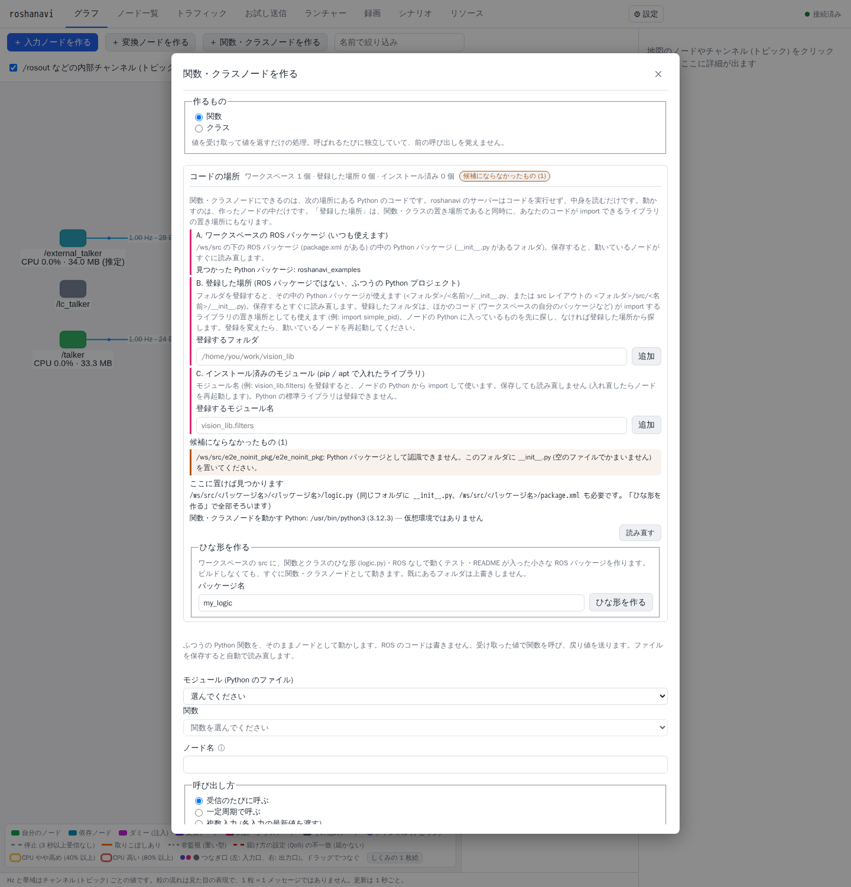
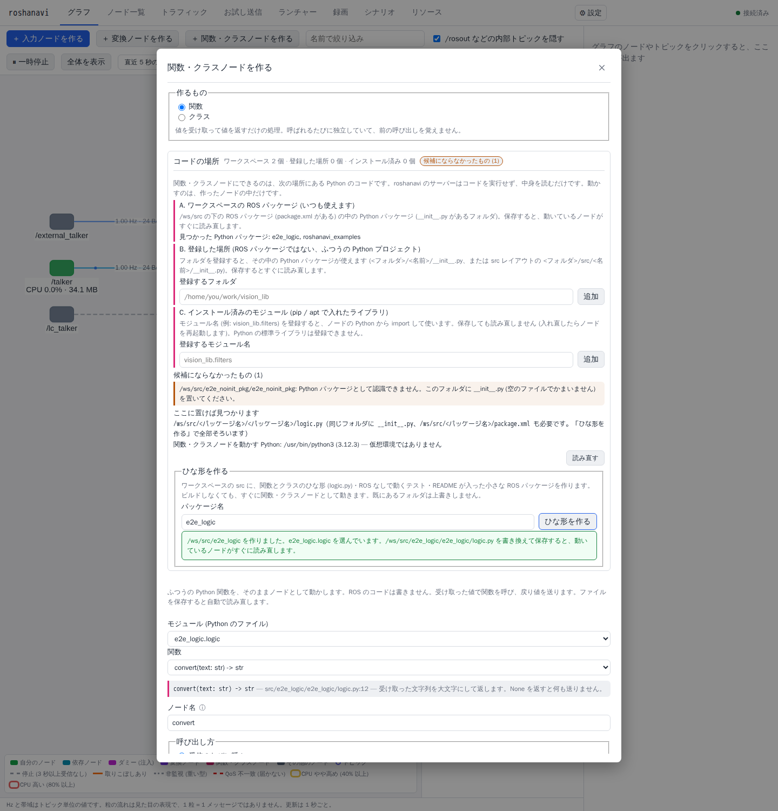
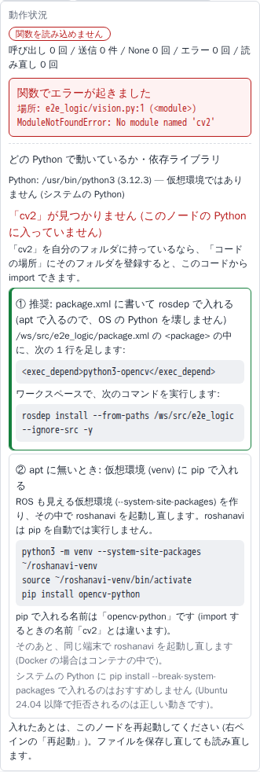

# 自分のコードを関数・クラスノードにする — 置き場所・ひな形・依存

関数・クラスノード ([nodes.md#関数ノード](nodes.md#関数ノード-ふつうの関数をそのままノードにするp55)、[nodes.md#クラスノード](nodes.md#クラスノード-状態を持つ処理をそのままノードにする)) の「入口」の設計。ノード開発者が毎日触る部分なので、利用者が迷わないこと、環境を壊さないこと、失敗したときに次の一手が分かることを最優先にする。使い方は利用ガイド [guide/user-code.md](../guide/user-code.md)、安全の判断は [security.md#入力された式・コード](security.md#入力された式コード)。

## 1. 想定する利用者の状況

| # | 状況 | 例 |
|---|---|---|
| U1 | これから書く | ロジックをまだ書いていない。どこに何を置けばよいか知らない |
| U2 | 既に ROS パッケージ (ament_python) の中にロジックがある | `my_pkg/my_pkg/logic.py` |
| U3 | ROS パッケージ (ament_cmake + ament_cmake_python) の中に Python がある | C++ ノードと同じパッケージに Python のヘルパー |
| U4 | ROS と関係ない普通の Python プロジェクトにある | `~/work/vision_lib/` (pyproject.toml、src レイアウトのことも) |
| U5 | pip / apt でインストール済みのライブラリの関数を使いたい | 社内ライブラリ、OSS ライブラリ |
| U6 | ロジックが依存ライブラリ (numpy、OpenCV、torch など) を使う | — |
| U7 | ロジックが git のサブモジュールにある | `src/vision_lib` がサブモジュール |

## 2. 置き場所 (探す範囲)

実装: `function/scopes.py` (A・B と登録の検査)、`function/installed.py` (C)、`function/modules.py` (一覧と解決)。

| 範囲 | 既定 | 対象 | 何を探すか | 包含の根 |
|---|---|---|---|---|
| A. ワークスペースの ROS パッケージ | 有効 | U1, U2, U3 | `<ws>/src/**/package.xml` を持つパッケージの直下の Python パッケージ (`__init__.py` のあるフォルダ。ament_python の `<pkg>/<pkg>/`)。ament_cmake のパッケージは `CMakeLists.txt` の `ament_python_install_package(<name> [PACKAGE_DIR <dir>])` も読む (`${PROJECT_NAME}` などは置き換え、ほかの変数は読めないので無視) | `<ws>/src` の realpath |
| B. 登録した場所 | 無効 (利用者が追加) | U4 | プロジェクトファイルの `code_paths:` のフォルダ。そのフォルダ自体がパッケージ (`__init__.py` あり)、flat レイアウト (`<path>/<pkg>/__init__.py`)、src レイアウト (`<path>/src/<pkg>/__init__.py`) を認識する。相対パスはワークスペースから、`~` は展開する | 登録したフォルダの realpath |
| C. インストール済みのモジュール | 無効 (利用者が追加) | U5 | プロジェクトファイルの `installed_modules:` のモジュール名 (例 `vision_lib.filters`) とその下のモジュール。**ノードを動かす Python の検索パス**の上で探す | (検索パスそのもの) |

- **探す順番**: A → B → C。同じトップの名前が複数の範囲にあれば先の範囲が使われ、後のものは「候補にならなかったもの」に `name_collision` として出る (A の中の重複も同じ)。ソースから読むもの (A・B) は import 時に `sys.modules` にその名前で入るので、混ぜることはできないため。
- **使えない名前** (A・B): Python の標準ライブラリ (`sys.stdlib_module_names`)、roshanavi のノード自身が使うもの (`rclpy`、`numpy`、`yaml`、`std_msgs` など、`scopes.NODE_RUNTIME_TOPS`)、`roshanavi`。そのパッケージを読み込むと、ノードの中の同じ名前のライブラリを置き換えてしまうため。ノードの中でも、既に `sys.modules` にある利用者のものでないモジュールと同じ名前なら読み込まない (二重の守り)。
- **C の場所の解決は import しない** (`installed.locate`): `importlib.util.find_spec('a.b')` は親の `a` を import してしまうので、標準の path finder と同じ順に検索パスを自分で調べる。各ディレクトリで「`__init__.py` のあるパッケージ → 拡張モジュール (`.so`) → `<name>.py`」、`__init__.py` の無いディレクトリは名前空間パッケージ (PEP 420) の一部として、どこにも普通のものが無いときだけ使う。setuptools の editable install (`__editable___*_finder.py` の `MAPPING`) は `ast.literal_eval` で読む (最後の手段。本物の finder も `sys.meta_path` の最後に入る)。見つけたファイルは `ast` で一覧する。**拡張モジュール (.so) だけ**のものは一覧できない旨を出し、関数名を手入力する (`listable: false`)。
- **C の検索パスはノードの Python のもの**: サーバーは「ノードを動かす Python」に一度だけ `sys.path` などを尋ねる (`function/python_env.py`: `<python> -c <probe>`、argv のリスト、シェルなし、10 秒、5 分キャッシュ。利用者のコードは import しない)。venv を使っているときにサーバーの `sys.path` で探すと、見つかるものが違うため。
- **C に標準ライブラリは登録できない** (`os`、`subprocess` など。スキーマで拒否し、解決でも拒否)。`os.system` を関数ノードにすると、そのトピックに送れる誰でもコマンドを実行できてしまうため。
- **安全の原則は変えない**: サーバーは利用者のコードを import しない (一覧は構文解析だけ)。実行は独立したノードのプロセスで行う。読み込めるのは A、および利用者が明示的に登録した B・C だけ。A・B は realpath がその範囲の根の内側にある通常ファイルだけ (内向きのシンボリックリンクは使え、外向きは拒否)。`.git` (と隠しディレクトリ) は辿らない。
- **B は「ライブラリの置き場所」でもある** (`function/code_imports.py`): 登録したフォルダは、関数・クラスの取り出し元であるだけでなく、**ノードの中のコードが `import` するライブラリ**の置き場所にもなる (例: A の `turtle_patrol.goto` が `import simple_pid` し、`simple_pid` は登録した `/opt/third_party/simple-pid` にある)。ノードのプロセス (サーバーではない) の `sys.meta_path` の**いちばん最後**に、登録した場所だけを探す finder を入れる。標準ライブラリ・`sys.path` (site-packages、ROS の install) で見つからなかったときだけ使われるので、**同じ名前のライブラリが環境に入っていれば環境のものが勝つ** (`sys.path` の最後に足すのと同じ順序)。探す場所は B の検査を通った登録済みフォルダだけで、フォルダごとに、そのフォルダ (flat)・`src/` (src レイアウト)、フォルダ自体がパッケージならそのパッケージだけ (兄弟のファイルは出さない)。**使えない名前** (標準ライブラリ・`rclpy`・`numpy` など `is_reserved_top`、`tests` / `docs` など隠しフォルダ・置き場所でない名前) は依存としても出さない (`json/` を含むフォルダがあっても標準ライブラリは置き換わらず、環境に無い `winreg` のような標準ライブラリの名前も出さない)。見つけたファイルの realpath が登録したフォルダの内側にあることを確かめ (外向きのシンボリックリンクは拒否)、`__init__.py` の無い名前空間パッケージも出さない。C はノードの Python の検索パス上にあるので、そのまま `import` できる (B のライブラリも C のコードから使える)。サーバーは何も import せず、助言のために `PathFinder.find_spec` で場所を調べるだけ。
- **ホットリロード**: finder が実際に出した名前 (`served`) のモジュールだけを、兄弟モジュールと同じ「`sys.modules` から外して新しく import し直す」の対象にし、見張るファイルにも加える。フォルダの中にあるだけのもの (プロジェクトの中の `.venv` のライブラリなど) は対象にしない。読み込みに失敗したら古いモジュールに戻る。登録した場所そのものの変更 (追加・削除) は、動いているノードを再起動すると反映される。
- ビルドは不要: A・B はソースから直接読み込むので、保存すればすぐ反映される (ホットリロード、同じパッケージの別モジュールの変更も)。C は通常の import で、保存しても読み直さない (入れ直したらノードを再起動)。
- プロジェクトファイル: `code_paths:` (最大 20、制御文字なし、1024 文字まで、重複なし) と `installed_modules:` (最大 50、モジュール名の形、重複なし、`roshanavi` と標準ライブラリは不可)。スキーマは `launcher/schema.py` (`CodeSettings`、`ProjectSpec`。pydantic 1 / 2 の両方で `pydantic_compat` 経由)。ノードの設定 YAML にも同じ 2 つを書き、ノードはサーバーと同じ規則でモジュールを解決する (C はノード自身の `sys.path` で)。
- **B に登録できない場所** (`scopes.check_code_path`): 存在しないフォルダ、`/`・`/usr`・ホームディレクトリそのものなど広すぎる場所、`.git` の中、data フォルダ (アップロード・録画の置き場) とその中・それを含むフォルダ。保存済みの項目が後で消えた場合は、一覧から外れ、理由に `code_path_invalid` と出る (エラーにはしない)。

### git のサブモジュール (U7)
- roshanavi は git を操作しない。サブモジュールは、利用者が (Docker を使う場合はその外で) `git submodule update --init --recursive` を済ませている前提とする。
- 同期済みのサブモジュールは普通のディレクトリとして扱う (ROS パッケージなら A、そうでなければ B として登録して使う)。サブモジュールの中の `.git` (ファイル) は辿らない。
- `.gitmodules` は文字として読むだけ (`path = ...` の行。根の外を指すものは無視)。読む場所: ワークスペースの根、`src`、`src` の下で `.gitmodules` を持つフォルダ、B の各フォルダ。

## 3. 見つからないときの案内

実装: `function/code_report.py`、`GET /api/functions/locations`。

関数・クラスノードの作成画面の「**コードの場所**」に、範囲ごとに見つかったもの、「**ここに置けば見つかります**」(利用者のワークスペースの実際のパス)、探した結果候補にならなかったものを理由付きで出す。理由の文と次の一手は UI の i18n (`i18n/messagesCode.ts` の `code.problem.<code>`)。

| 検出した状況 | code | 表示する理由と次の一手 |
|---|---|---|
| `__init__.py` がない (`.py` があるフォルダ) | `no_init` | 「Python パッケージとして認識できません。`__init__.py` を置いてください」 |
| `__init__.py` が無いフォルダの中にパッケージがある (名前空間パッケージ) | `namespace_package` | 「ソースから読み込むには `__init__.py` を置く。インストール済みなら C に登録」 |
| ROS パッケージの直下に `.py` がある (`setup.py` などを除く) | `loose_files` | 「`<pkg>/<pkg>/` を作り `__init__.py` と一緒に移す」 |
| package.xml がないディレクトリ (src の下、Python のファイルを含む) | `not_ros_package` | 「ROS パッケージではありません。ひな形を作るか、『コードの場所を登録』してください」 |
| 構文エラー | `syntax_error` | ファイル名・行番号・エラー内容 |
| トップレベルに関数・クラスがない (`__init__.py` は除く) | `no_members` | 「関数またはクラスが見つかりません (クラスの中の関数や、`if __name__ == ...` の中は対象外です)」 |
| 名前が `_` で始まるものしかない | `private_only` | 「内部用の名前として扱っています」 |
| `.gitmodules` に登録されているのに中身が空 (サブモジュール未同期) | `submodule_empty` | 「サブモジュール `<パス>` の中身がありません。`git submodule update --init --recursive` を実行してください」(実行する場所も出す) |
| ワークスペース (B は登録した場所) の外を指すシンボリックリンク | `outside_symlink` | 「安全のため、ワークスペースの外は読み込みません。『コードの場所を登録』してください」 |
| 使えない名前 (標準ライブラリなど) | `reserved_name` | 「名前を変えてください」(roshanavi 自身のソースは出さない) |
| 同じ名前が 2 か所 | `name_collision` | どちらを使い、どちらを使わないか |
| 登録した場所が使えない・空 | `code_path_invalid` / `code_path_empty` | 理由 |
| 登録したモジュールがノードの Python に無い | `installed_not_found` | 「入れた先の Python が違うかもしれません」 |

足りないライブラリ (依存) の案内は §5。

- 一覧の関数の候補にならなかった名前も、モジュールの説明 (`GET /api/functions/module` の `skipped[{name, line, reason: private | async | main_guard}]`) で出す。
- 走査は上限付き (理由 200 件、構文を確かめるファイル 500、深さ)。解析した木はファイルの (mtime, サイズ) でキャッシュする (`function/signatures.py`)。

## 4. ひな形を作る

実装: `function/scaffold.py`、`POST /api/functions/scaffold {name}`。

ボタン 1 つで、ワークスペースに最小の ROS パッケージを生成する (U1 向け)。

```
<ws>/src/<名前>/
  package.xml          依存の書き方の例をコメントで記載 (XML のコメントに -- は書けないので、rosdep のコマンドは README に)
  setup.py / setup.cfg colcon build もできる ament_python の最小構成 (setup.cfg に [tool:pytest] pythonpath = .)
  resource/<名前>
  <名前>/__init__.py
  <名前>/logic.py      関数 convert(text: str) -> str と、クラス Processor (__init__(prefix) / process / reset)
  test/test_logic.py   ROS なしで動く pytest (`cd src/<名前> && python3 -m pytest test`)
  README.md            関数ノード・クラスノードとして動かす手順、テスト、依存 ①②
```

- 名前は利用者が入力する (既定値 `my_logic`)。ROS のパッケージ名の規則 (小文字で始まり小文字・数字・`_`、`__` と末尾の `_` は不可、64 文字まで) と Python の名前として検査し、Python の予約語・標準ライブラリ・ノードが使う名前、既にある ROS パッケージ (ワークスペースと環境)・A / B の Python パッケージの名前は断る (`invalid_package_name` / `name_taken` 409)。
- **上書きしない**: 既にあるフォルダ (シンボリックリンクも) は 409 `file_exists`。フォルダは `mkdir`、ファイルは `O_EXCL` で作る。途中で失敗したら、自分が作ったものだけを消す。書けない (読み取り専用) なら 403 `not_writable`。生成する `.py` は書く前に `compile()`、package.xml は XML として読めることを確かめる。値は検査済みの名前だけ。
- 生成後、そのまま関数・クラスノードの作成画面に戻り、生成した関数 (クラスを選べばクラス) が選ばれた状態にする。
- 確かめたこと (テスト): ひな形 → ビルドせずに関数ノードとしてもクラスノードとしても動く → `colcon build --packages-select <名前>` が通る → 生成された pytest が通る。

## 5. 依存ライブラリ

実装: `function/dependencies.py` (サーバー: rosdep と案内)、`function/node_env.py` (ノード: Python と requirements.txt)、`function/python_env.py` (サーバー: ノードの Python の選択と検索パス)、`GET /api/functions/dependency`。

**roshanavi は pip を自動で実行しない。** コマンドを表示するだけにする (利用者の環境を壊さない、企業の審査で問題にならない)。

| 推奨度 | 方法 | 案内 |
|---|---|---|
| ① 推奨 | `package.xml` の `<exec_depend>` + `rosdep install` | apt で入るので OS を壊さない。numpy、OpenCV など主要なものは rosdep キーがある |
| ② 代替 | `requirements.txt` + 仮想環境 | apt にないライブラリ用。`python3 -m venv --system-site-packages` で ROS も見える仮想環境を作り、その中で roshanavi も起動する手順を案内する |
| 非推奨 | システムの Python への `pip install --break-system-packages` | Ubuntu 24.04 以降 (PEP 668) で拒否されるのが正しい挙動。案内しない |

- **足りないライブラリの検出**: ノードで `ModuleNotFoundError` が出たら (読み込み時、呼び出し時、クラスの `__init__`)、状態の問題に `missing_module` (例 `cv2`) を付ける。利用者自身のパッケージの中のモジュールが無い場合 (`from .not_there import x`) は依存ではないので付けない。`raise ImportError(...) from ModuleNotFoundError` も 1 段たどる。
- **モジュール名 → rosdep キー**: 名前が違うよく知られたもの (`cv2` → `python3-opencv`、`yaml` → `python3-yaml`、`PIL` → `python3-pil`、`sklearn` …) の表、次に `python3-<名前>` を候補にし、**rosdep 自身のデータベース**で確かめる (`rosdep resolve <key>`。argv のリスト、シェルなし、10 秒、結果をキャッシュ)。**apt で入るキーだけ**を ① にする (`*-pip` のキーは pip を実行するので使わない)。rosdep が無い・`rosdep update` をしていない (オフラインで一度も更新していないなど)・時間切れは「確かめられなかった」として、確かめていない候補のキーと ② の両方を出す (`sudo rosdep init` と `rosdep update` を案内)。
- **登録した場所を先に調べる** (`dependencies.code_places`): `ModuleNotFoundError` のライブラリが (a) 登録した場所にある → rosdep も pip も出さず「ノードを起動したあとで登録したようです。再起動してください」(`route: code_path_restart`)、(b) 登録した場所のフォルダ名がそのライブラリの名前 (`simple-pid` と `simple_pid`) なのに中にない → 「登録した場所 `<path>` に `<module>` が見つかりません」(`route: code_path_missing`。`rosdep` は調べない、`status: skipped`)、(c) どちらでもない → 今までの rosdep / venv の案内に加えて、登録した場所が 1 つ以上あれば「登録した場所 (…) には `<module>` がありません」、なければ「自分のフォルダに持っているなら『コードの場所』に登録すると import できます」を添える。B を登録していれば `import simple_pid` はもう `ModuleNotFoundError` にならない (登録していない・場所を間違えたときだけここに来る)。
- ① の内容: そのコードの ROS パッケージの `package.xml` の実際のパス、足す 1 行 (`<exec_depend>python3-opencv</exec_depend>`)、既に書いてあるか (コメントアウトは数えない)、`rosdep install --from-paths <パッケージの実際のパス> --ignore-src -y`。B のコードは ROS パッケージではないので、`sudo apt install <apt のパッケージ名>` を出す。
- ② の内容: `python3 -m venv --system-site-packages ~/roshanavi-venv` → `source ~/roshanavi-venv/bin/activate` → `pip install <pip の名前>` (requirements.txt があれば `pip install -r <実際のパス>`)。pip の名前が import の名前と違うもの (`cv2` → `opencv-python`) はそう書く。ノードが既に venv で動いていれば、その Python に入れる 1 行 (`<python> -m pip install …`) だけ。
- **venv で roshanavi を起動したとき**: サーバーが venv の中で動いている、または起動した端末で venv が有効 (`VIRTUAL_ENV`) なら、関数・クラスノードを `ros2 run --prefix <venv>/bin/python3 roshanavi function …` で起動する (`--prefix` の値はサーバーが決め、クライアントからは渡せない)。こうしないと、エントリスクリプトの shebang (`/usr/bin/python3`) の Python で動き、venv に入れたものが見えない。venv が無ければコマンドは今までどおり。
- **requirements.txt の照合** (ノードの中、`node_env.check_requirements`): 関数を置いたパッケージ (A: ROS パッケージのフォルダ、B: 登録したフォルダ、と Python パッケージの親) に `requirements.txt` があれば、書かれているものとノードの Python に入っているもの (`importlib.metadata`、名前は PEP 503 で正規化) を照らし合わせ、足りないもの・版が合わないものを一覧にする。`packaging` があれば版と環境マーカーも確かめ、無ければ入っているかだけ (条件付きの行は確かめない)。`-r` / `-e` / URL / パスの行は確かめない。読み込みに失敗したときも照合する (足りないものが原因のことが多いため)。
- **どの Python で動いているか**: 「コードの場所」にサーバーが尋ねたノードの Python (場所・版・仮想環境か)、ノードの右ペインにノード自身が報告する Python (`environment.python`: `sys.executable`・版・`sys.prefix`・venv か) を出す (「venv に入れたのに見つからない」の原因を特定しやすくする)。
- 注: ROS 2 のノードでは numpy は必ずある (rclpy 自身が import する)。依存不足の例とテストには OpenCV (`cv2`) を使う。

## 6. よくあるつまずきへの対応

| つまずき | 対応 |
|---|---|
| 相対 import (`from .utils import x`) | パッケージとして読み込むので動く (テストで保証) |
| 同じパッケージ内の別モジュールを書き換えた | ホットリロードの監視対象に含める (読み込まれた同じパッケージのモジュールすべて。内向きのリンク先も) |
| 登録した場所 (B) のライブラリを書き換えた | 同じ扱い (§2 の「B はライブラリの置き場所でもある」。finder が出したモジュールだけを新しく import し直す) |
| モジュールの読み込み時に重い処理・ROS の初期化をしている | 読み込みに 1 秒以上かかったら `slow_import` の通知 (秒数付き)。ガイドで、重い処理はクラスの `__init__` に移すよう案内する |
| モジュールの中で `rclpy` を import している | 動かせるが、関数ノードの外で ROS を使う設計は混乱の元なので注意を出す (`imports_rclpy`。作成画面ではそのモジュール、ノードでは読み込んだパッケージのファイル) |
| 型注釈が無い | データの種類を手で選んでもらう (現状どおり) |
| 拡張モジュール (.so) を含むライブラリ | 読み込めるが、ホットリロードは効かない旨を出す (`extension_module`: C の拡張モジュールそのもの、`extension_no_reload`: A・B のパッケージに .so がある) |
| インストール済みのモジュール | 保存しても読み直さない旨を出す (`no_hot_reload_installed`) |

## 7. API と画面

- `GET /api/functions/modules`: 各モジュールに `scope` (`workspace` / `code_path` / `installed`)・`source`・`listable`。`file` はワークスペースの中なら相対、外なら実際の絶対パス。
- `GET /api/functions/module?name=`: `scope`・`listable`・`skipped[]`・`notices[]` も返す。拡張モジュールは `functions` / `classes` が空で `listable: false`。
- `GET /api/functions/locations[?refresh=true]`: `{workspace, src, src_exists, src_writable, scopes{workspace{root, packages[]}, code_paths[{path, real, status, error?, packages[{top, dir, layout}]}], installed_modules[{module, status: found | not_found | extension | namespace | shadowed, file, listable}]}, problems[{code, ...}], place_here[{scope, root}], python{executable, version, prefix, venv, error?, forced}, settings{code_paths, installed_modules}}`。
- `PUT /api/functions/locations {code_paths, installed_modules}`: 新しく足したフォルダだけを検査 (400 / 404 `invalid_code_path`)、保存 (プロジェクトファイルに自動保存)。動いているノードは再起動すると新しい場所を使う。
- `POST /api/functions/scaffold {name}` → 201 `{package, directory, module, function, class_name, files[]}`。
- `GET /api/functions/dependency?missing=cv2&module=pkg.mod` → `{missing, top, rosdep{status: found | not_found | unavailable | skipped, key?, installer?, packages?, reason?, candidate?, tried}, route: rosdep | venv | code_path_restart | code_path_missing, code_places{registered[{path, real}], found_in?{path, real, file}, looks_like?{path, real}}, exec_depend?, apt_command?, package_xml?, already_declared?, rosdep_command?, venv{pip_name, pip_name_differs, requirements, commands[], active}, python, note?}`。
- 関数・クラスノードの状態 (`function_status`) に `environment{python, scope, loaded_from, requirements[]}`・`notices[]`・`import_seconds`、問題に `missing_module`。
- 画面の「コードの場所」には、登録した場所は関数・クラスの置き場所であると同時にコードが import できるライブラリの置き場所でもあることを書く (`code.intro`、B の説明)。画面 ([ui.md#実装メモ (P5.5 …)](ui.md#実装メモ-p55-データの種類詳細設定モード関数ノードクラスノード)): 作成画面の「コードの場所」(`function/CodeLocationsPanel.tsx`。使えるコードがまだ無いときは開いた状態)、モジュールの一覧は範囲ごとのグループ (`ModuleSelect.tsx`)、候補にならなかった名前と通知、拡張モジュールは関数名の手入力。ノードの右ペイン・編集画面の動作状況に `DependencyPanel.tsx` (Python・requirements.txt の照合・通知・足りないライブラリの ①②)。





## 8. 検証

状況 U1〜U7 を実際のディレクトリ構成の fixture としてテストの中で作り (`test/user_code_fixtures.py`)、すべて統合テストする。項目と状態は [testing.md#T. 自分のコード](../project/testing.md#t-自分のコードを関数クラスノードにする-置き場所ひな形依存)。
