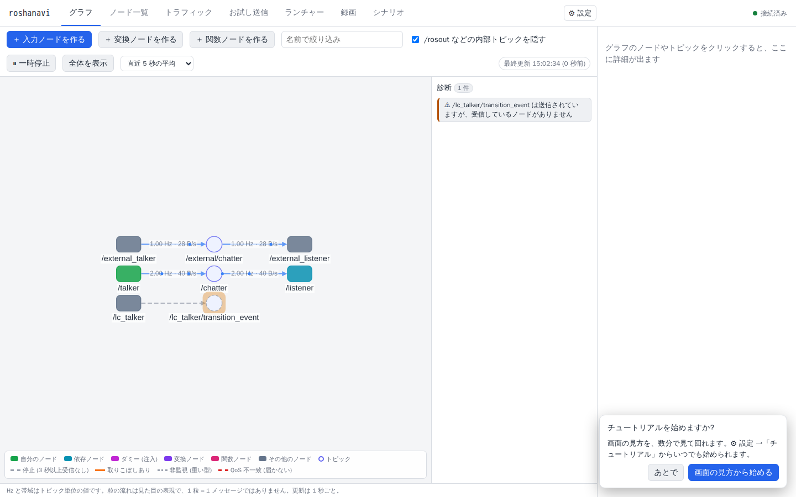
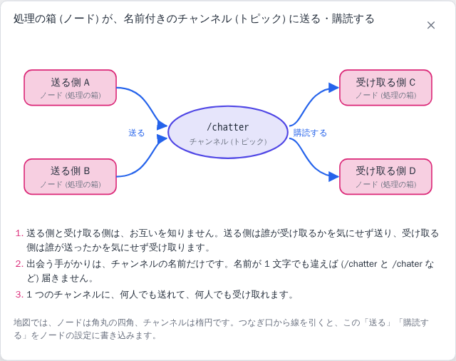

# はじめての起動と画面の見方

roshanavi を Docker で動かして、画面を一通り見て回るまでの手順です。ROS 2 がパソコンに入っていなくても試せます。自分のプロジェクトで使う方法は、この章のあとの [入力を流す](inputs.md)、[自分のコードを関数・クラスノードにする](user-code.md)、[Docker で動いている既存のプロジェクトに入れる](docker-integration.md) などを見てください。

## 1. 起動する (Docker)

必要なものは Docker と Docker Compose だけです。

```bash
git clone https://github.com/shimejilib/roshanavi.git
cd roshanavi && docker compose up -d --build lab demo
```

初回はイメージのビルドに時間がかかります。終わったらブラウザで http://localhost:6871 を開きます。

- `lab` が roshanavi 本体、`demo` が見本のノード (talker / listener と、roshanavi の外から動かしているノードの例) です。
- 止めるときは `docker compose down` です。
- ポートは自分のパソコンの中 (`127.0.0.1`) にだけ開きます。別のパソコンから見る方法は [別のマシンから roshanavi を見る (SSH)](remote-ssh.md) にあります。
- ROS 2 のバージョンを選ぶときは `ROS_DISTRO=lyrical docker compose up -d --build lab demo` のように付けます (既定は Jazzy)。

初回は画面に「チュートリアルを始めますか?」と出ます。「画面の見方から始める」を押すと、この章の内容を画面上の案内つきで数分で見て回れます。



## 2. 画面の構成

上に並ぶタブで機能を切り替えます。右上の「⚙ 設定」からは、チュートリアルの開始、詳細設定モード、プロジェクトの切り替えができます。

| タブ | 何をする所か | 詳しい章 |
|---|---|---|
| グラフ | ノードとチャンネル (トピック) のつながりを、リアルタイムの地図で見る。診断 (うまくつながっていない所の指摘) も出る | この章 |
| ノード一覧 | 動いているノードを表で見る。チェックを付けてまとめて起動・停止・再起動 | [既存の起動セットごと動かす](takeover.md) |
| トラフィック | チャンネルごと・ノードごとの、1 秒あたりの回数 (Hz)、帯域、取りこぼし、遅れ | [測る](measure.md) |
| お試し送信 | 文字や画像などを、その場で 1 回・繰り返し送る | [入力を流す](inputs.md) |
| ランチャー | 自分のノードを起動・停止し、ログを見て、ビルドする | [Docker で動いている既存のプロジェクトに入れる](docker-integration.md)、[既存の起動セットごと動かす](takeover.md) |
| 録画 | 流れているデータを録っておき、あとで同じ入力として再生する | [入力を流す](inputs.md) |
| シナリオ | 「こう入力したら、こう出る」を記録して、自動で確かめる | [シナリオで確かめる](scenarios.md) |
| リソース | ノードごとの CPU・メモリ、パソコン全体の状況、メモリリークの疑い | [測る](measure.md) |

## 3. 地図 (グラフ) の読み方


- **角丸の四角がノード** (処理の箱)、**楕円がチャンネル (トピック)** (名前の付いたデータの通り道) です。線の向きがデータの流れで、左から右へ「入力 → 処理 → 出力」と並びます。
- **ノードの色**は役割です。自分のノード (緑)、依存ノード (シアン)、ダミー (マゼンタ)、その他 (グレー) で、左下の凡例で確かめられます。「自分のノード」は自分が開発しているノードで、ランチャーなどで指定します。
- **線のラベル**は `10.0 Hz · 1.2 MB/s` のように、1 秒あたりの回数と帯域です。太い線ほど流れが多く、流れている向きに粒が動きます。粒は見た目の表現で、1 粒が 1 メッセージではありません。
- **線の色**は状態です。青の実線は通信中、グレーの破線は 3 秒以上止まっている、橙は取りこぼしあり、グレーの点線は重いデータなので既定では計測していない、赤い破線は届け方の設定 (QoS) が合わず届かない、です。
- **ノードやチャンネルをクリック**すると、上流・下流だけが濃く残り、右側に詳細が出ます (流れているデータの中身、Hz、型など)。ノードのパネルには「受信しているデータ」「送信しているデータ」が並びます。表示しているのはチャンネルに流れているデータで、そのノードが受け取ったとは限りません。
- **右クリック**でメニューが開きます。ノードなら停止・再起動・ログ・設定値 (パラメータ) の確認、チャンネルなら中身を見る・お試し送信・入力ノードを作る・録画、線なら届かない理由です。roshanavi が起動していない外部のノードは、停止などが灰色になり理由が出ます (roshanavi は自分が起動していないプロセスには何もしません)。
- ツールバーでは、名前での絞り込み、一時停止 (表示を固定して観察)、全体表示ができます。ノードはドラッグで動かせて、動かした位置は覚えます。
- 画面は 1 秒ごとに更新されます。Hz の「直近 5 秒の平均」は 1 / 5 / 10 秒から選べます。ツールバーの「最終更新」が古くなったら、サーバーとの接続が切れています。

### 診断のバッジ

地図の上の「診断」に件数が出ます。ROS に慣れていないとつまずきやすい所を、roshanavi の側から指摘するものです。

| 出る指摘 | 意味 |
|---|---|
| 届け方の設定 (QoS) の不一致 | 送る側と受け取る側の約束が合わず、つながっていません。理由が文で出ます (例: 送信側は BEST_EFFORT、受信側は RELIABLE のため届きません) |
| 名前が似ているチャンネル | `/cmd_vel` と `/cmdvel` のように、片方にしか送る側 (または受ける側) がいません。打ち間違いかもしれません |
| さっきまでいたのにいなくなった | 直近 5 分に送受信していたノードが消えました。落ちたか、止めたかもしれません |
| 開発中のノードの入力が空 | 「自分のノード」が受け取るチャンネルに、送ってくるノードがいません |
| データの形 (メッセージ型) の不一致 | 同じ名前のチャンネルに、違う形のデータが混ざっています |

**「受信なし」「送信なし」** は診断ではなく、チャンネル名の下に出る控えめな印です。「今は送るだけで受け取る人がいない」「今は受け取り待ちで送る人がいない」という状態で、組み立て中は普通なので、診断の件数には数えません。

## 4. チュートリアル

⚙ 設定 →「チュートリアル」から、いつでも始められます (途中でやめても、続きから再開できます)。

| チュートリアル | 内容 |
|---|---|
| 画面の見方 | 地図・凡例・診断・トラフィック・ノード一覧を見て回る (操作なし) |
| はじめての入力ノード | 文字を送るノードを作り、流れるデータを見る |
| 届かない原因を見つけて直す | 赤い破線の理由を読んで、設定を直す |
| 関数ノードを作る | 普通の関数をノードとして動かす |
| シナリオを記録する | 操作と結果を記録して、テストとして実行する |

「画面の見方」の2つ目の手順では、ノードとチャンネルの関係を1枚の図で説明します。あとから地図の凡例の「しくみの 1 枚絵」でも開けます。



知っておくことは「ノードはチャンネルに送り、チャンネルを購読して受け取る」だけです。

## 5. 次にやること

- 文字や画像を流して、ノードの反応を見る → [入力を流す](inputs.md)
- 自分の Python の関数を、そのままノードにする → [自分のコードを関数・クラスノードにする](user-code.md)
- 自分のプロジェクトに roshanavi を入れる → [Docker で動いている既存のプロジェクトに入れる](docker-integration.md) / [自分のワークスペースに入れる](install.md)

## うまくいかないとき

| 症状 | 確かめること |
|---|---|
| ブラウザで開けない | `docker compose ps` で `lab` が動いているか。ポート 6871 を別のものが使っていないか。別のマシンから開いているなら [SSH のポート転送](remote-ssh.md) が必要です |
| 地図が空で「ノードも…見つかりません」と出る | ROS_DOMAIN_ID (ノード同士の仲間分けの番号) が、見たいノードと同じか。Docker のネットワークが別になっていないか ([動いているシステムを見るだけ](observe.md)) |
| 画面の右上が「切断 (再接続中)」になる | サーバーが止まっています。`docker compose logs lab` を見てください。直ると自動でつながり直します |
| 画像や点群のチャンネルの Hz が出ない | 重いデータは既定では計測しません。チャンネルを選んで監視を ON にします ([測る](measure.md)) |
| ビルド後に画面が古いまま | 画面を変更した場合は `docker compose build lab` をして起動し直します |

## 仕組みを知りたい人へ

- 地図と診断の仕様: [design/map-and-traffic.md](../design/map-and-traffic.md)
- 画面の構成と右クリックメニュー: [design/ui.md](../design/ui.md)
- 言葉の対応表 (ROS の用語 → ふつうの言葉) と 1 枚絵: [design/wiring.md](../design/wiring.md)
