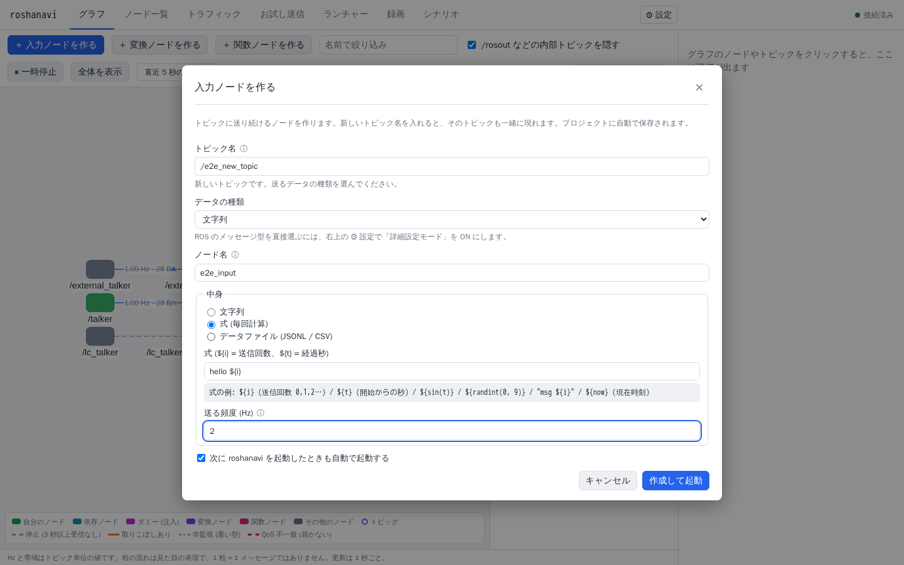
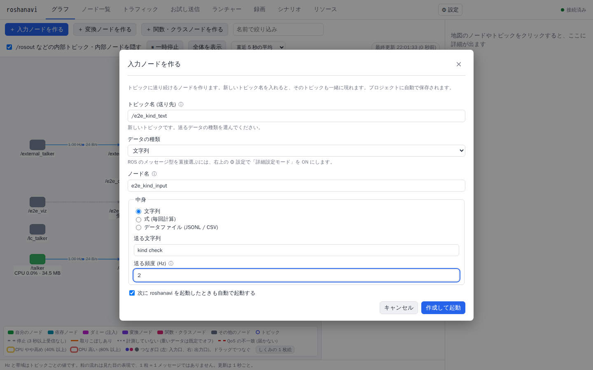
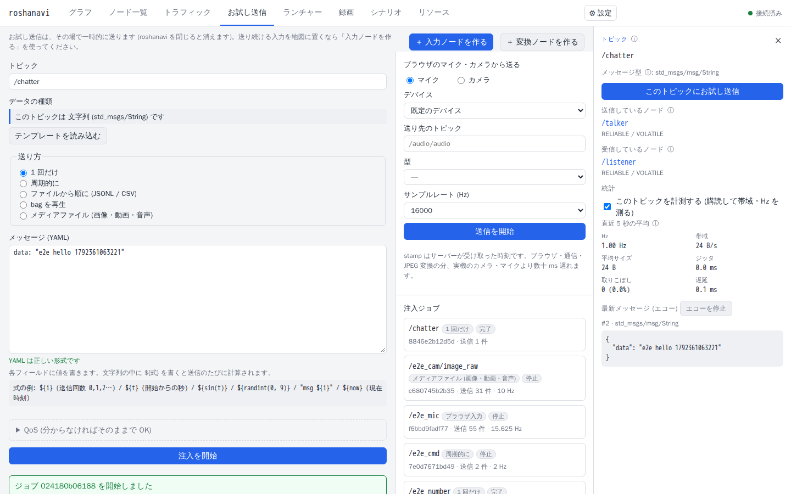
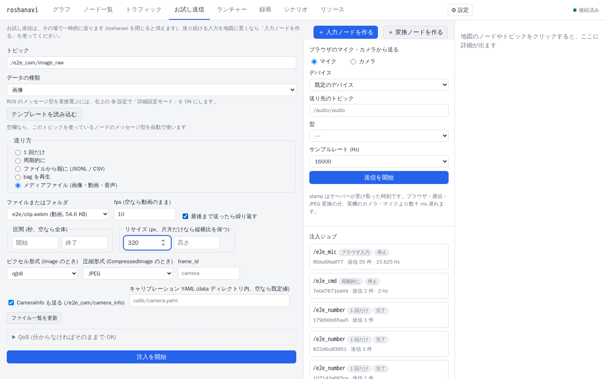
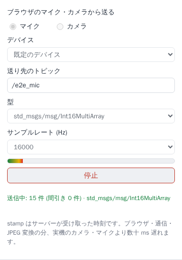
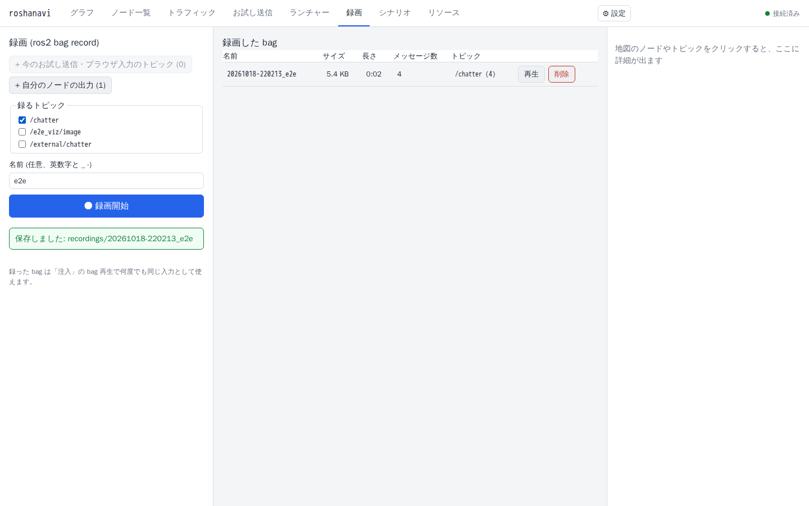

# 入力を流す

開発中のノードに、決まった入力を流して反応を見る方法です。センサーや相手のノードがまだ無くても、文字・数値・画像・動画・音声・マイクやカメラの映像を、ノードの入力としてその場で流せます。

使い分けの目安です。

| やりたいこと | 使うもの |
|---|---|
| ずっと流し続けたい (相手のノードの代わり) | **入力ノード** (常駐する、ダミーのノード) |
| 1 回だけ、または少しの間だけ流して試したい | **お試し送信** |
| 動画・画像・音声のファイルを流したい | 入力ノード、またはお試し送信の「メディアファイル」 |
| 自分の声やカメラの映像を流したい | ブラウザのマイク・カメラ取り込み |
| 同じ入力を何度も再現したい | 録画 → 再生 |

## 1. 入力ノードを作る

入力ノードは「このチャンネル (トピック) に、これを流し続ける」だけの、小さなノードです。作ると地図に現れます。「次に roshanavi を起動したときも自動で起動する」を選べば、再起動しても残ります。

1. 次のどれかで、作成のダイアログを開きます。
   - 地図のツールバーの「＋ 入力ノードを作る」
   - 地図の空いている所を右クリック →「ここにチャンネル (トピック) を追加」
   - 既存のチャンネルを右クリック →「入力ノードを作る」(そのチャンネルが送り先として入ります)
   - 「お試し送信」タブ
2. **チャンネル名 (送り先)** を入れます。先頭の `/` は補われます。まだ無い名前なら「新しいチャンネル (トピック) です」と出ます。
3. **データの種類**を選びます (下の表)。既存のチャンネルに送るときは、相手の型に合わせて自動で決まります。
4. **ノード名**(既定は `dummy_` + チャンネル名の末尾)、**中身**、**送る頻度 (Hz)** を決めます。
5. 「作成して起動」を押すと、ノードが作られて、すぐ流れ始めます。地図の右クリックから、一時停止・再開、中身や頻度の変更、停止ができます。

### データの種類

ROS のデータの形 (メッセージ型) の名前は知らなくて構いません。種類を選べば決まります。

| データの種類 | 中身の書き方 |
|---|---|
| 文字列 | そのまま書く、または式 |
| 数値 (小数) / 整数 | 値、または式 |
| ON / OFF | 選ぶ、または式 |
| 数値の並び / バイト列 | カンマ区切り |
| JSON (複数の値をまとめて) | JSON のテキスト |
| 画像 / 音声 | `data` フォルダ (Docker では手元の `./data`) に置いたファイルを選ぶ |

特別なデータの形 (例: `geometry_msgs/Twist`) を直接選びたいときは、⚙ 設定の「詳細設定モード」を ON にします。

### 式で毎回違う値を送る

中身に `${...}` と書くと、送るたびに計算されます。

| 書き方 | 意味 |
|---|---|
| `${i}` | 何回目の送信か (0, 1, 2 …) |
| `${t}` | 開始からの秒数 |
| `${sin(t)}` | 計算 (`sin cos sqrt abs min max round random randint(a,b)` など) |
| `msg ${i}` | 文字列の中に埋め込む (`msg 0`, `msg 1` …) |

入力した式は安全な範囲の計算だけを許す専用の仕組みで評価するので、危ないコードは動きません。使えない書き方をすると、理由が文で出ます。

## 2. お試し送信

「お試し送信」タブは、ノードを作らずにその場で送ります。

1. チャンネルを選ぶか入力します (地図で右クリック →「お試し送信」でも開きます)。型は自動で入ります。
2. 「テンプレートを読み込む」を押すと、送れるフィールドの一覧が出るので、値を書き換えます。
3. **送り方**を選びます。
   - 1 回だけ
   - 周期的に (Hz、回数を指定できます。空なら止めるまで)
   - ファイルから順に (JSONL または CSV を 1 行ずつ。`data` フォルダに置きます)
   - bag を再生 (録画したものを流す。下の「録画と再生」)
   - メディアファイル (次の節)
4. 「開始」で送り始めます。動いているものは一覧に出て、停止や一時停止ができます。「常駐ノードにする」を押すと、入力ノードとして残せます。

届け方の設定 (QoS) は、分からなければそのままで大丈夫です。

## 3. 画像・動画・音声のファイル

「お試し送信」の送り方で「メディアファイル」を選びます (入力ノードでも画像・音声ファイルを選べます)。ファイルは `data` フォルダの中に置きます。

| ファイル | どう送られるか |
|---|---|
| PNG / JPG / BMP / WebP (1 枚、またはフォルダ) | 画像として送る。フォルダなら名前順に切り替える (既定 1 秒に 1 枚) |
| MP4 / MOV / MKV / WebM / AVI | 1 コマずつ画像として送る。区間・大きさの変更、繰り返しができる |
| WAV / MP3 / FLAC / OGG / M4A | 音声として、実際の時間の速さで送る。サンプルレートやチャンネル数を相手に合わせられる |

- 送り先に受け取るノードがいれば、その型に合わせて送ります。誰もいないときは、使える型の一覧から選びます。
- 見本のメディアは、デモの起動時に `data/samples` にできます。
- 地図でチャンネルを選ぶと、右側に画像のビューアや音声の波形が出て、流れている中身を確かめられます。

## 4. ブラウザのマイク・カメラ

自分の声やカメラの映像を、そのまま入力にできます。

1. 「お試し送信」タブの右側の「ブラウザのマイク・カメラから送る」を開きます。
2. マイクかカメラ、使うデバイス、送り先のチャンネル、型 (自動のままで大丈夫です) を選びます。
3. カメラは解像度と fps、マイクはサンプルレートを選びます。プレビューや入力レベルが出ます。
4. 「送信を開始」を押すと、ブラウザの許可の確認が出ます。許可すると流れ始めます。

- ブラウザの決まりで、マイク・カメラは **`http://localhost` から開いたときだけ**使えます。別のマシンで動いている roshanavi は、[SSH のポート転送](remote-ssh.md)で `localhost` として開けば使えます。
- ブラウザからの送信が詰まると、そのコマは飛ばします (ノードは止まりません)。

## 5. 録画と再生

一度録っておけば、次からは毎回同じ入力を再現できます。自分の声やカメラ映像で 1 回録り、以後はそれを流してテストする、という使い方に向いています。

1. 「録画」タブで、録りたいチャンネルにチェックを付けます。「今のお試し送信・ブラウザ入力のチャンネル」「自分のノードの出力」というまとめ選びもあります。
2. 名前を付けて「● 録画開始」。終わったら「停止」を押します。経過時間が出ます。
3. 一覧に出た録画の「再生」で、元のチャンネルに同じ順序で流れます (お試し送信の「bag を再生」からも選べます)。
4. 「削除」は確認のダイアログが出ます。録画中のものは消せません。

- 録画は `data/recordings/` に保存されます (ROS 2 の bag 形式)。
- 空き容量が 1 GiB 未満 (または 5 % 未満) になると警告し、256 MiB 未満 (または 1 % 未満) になると自動で止めます。

## うまくいかないとき

| 症状 | 確かめること |
|---|---|
| 送ったのに、ノードが反応しない | 地図の診断に、届け方の設定 (QoS) の不一致が出ていないか。送り先のチャンネル名が、ノードが受け取るチャンネルと完全に同じか (似た名前の指摘が出ます) |
| チャンネル名を打ち間違えた | 地図の診断に「名前が似ている」と出ます。入力ノードを右クリックして直すか、作り直します |
| 「この型は作れない」と出る | その型は、入力ノードやメディアの送信に未対応です。録画した bag を再生してください |
| 「誰も使っていない」と出てメディアの型が決まらない | 送り先を受け取るノードがまだいません。表示された一覧から型を選びます |
| ファイルが一覧に出ない | `data` フォルダの中に置いたか。「ファイル一覧を更新」を押す |
| マイク・カメラが選べない / 許可が出ない | `http://localhost` で開いているか。別のマシンの IP アドレスで開いていると、ブラウザが許可しません |
| 画像のチャンネルの Hz が出ない | 重いデータは既定では計測しません ([測る](measure.md)) |
| 録画が自動で止まった | データフォルダの空き容量が足りません |

## 仕組みを知りたい人へ

- 入力ノードとデータの種類: [design/nodes.md](../design/nodes.md)
- 送信・式・メディア・録画の仕様: [design/input-and-media.md](../design/input-and-media.md)
