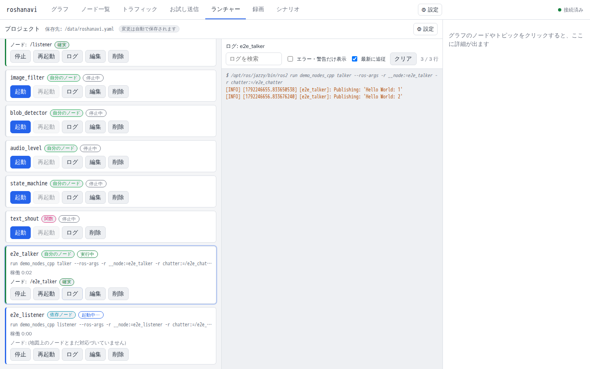
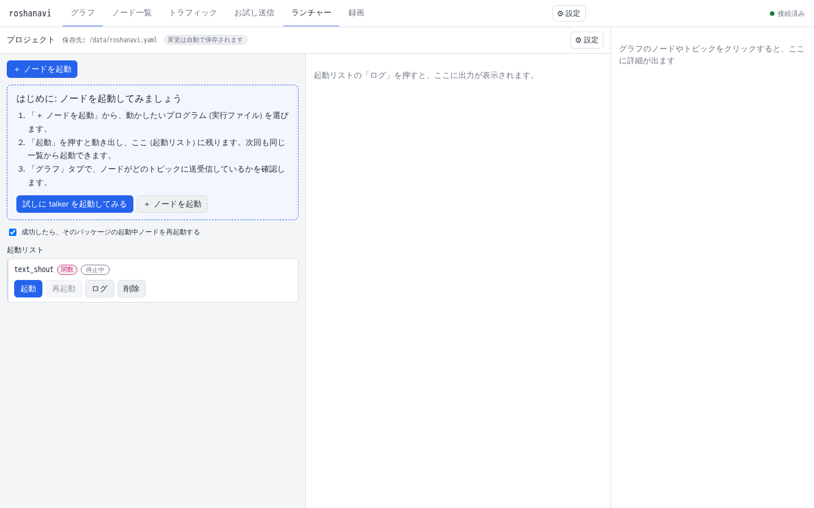
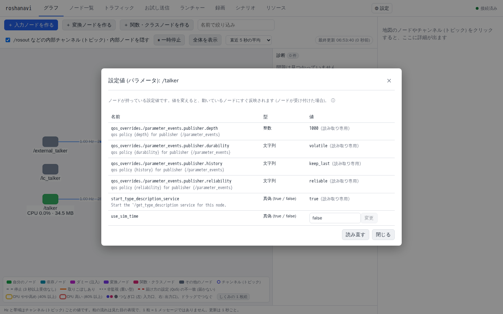
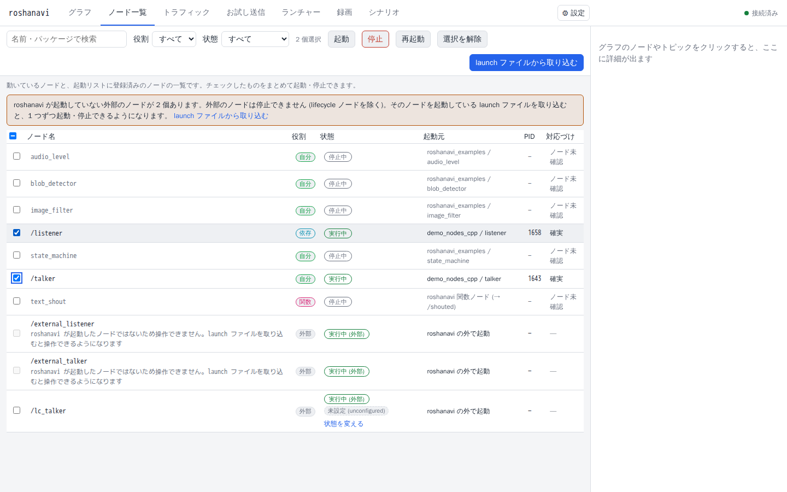
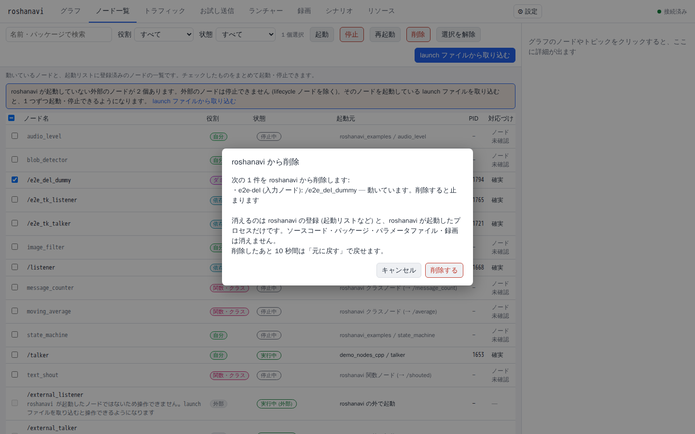
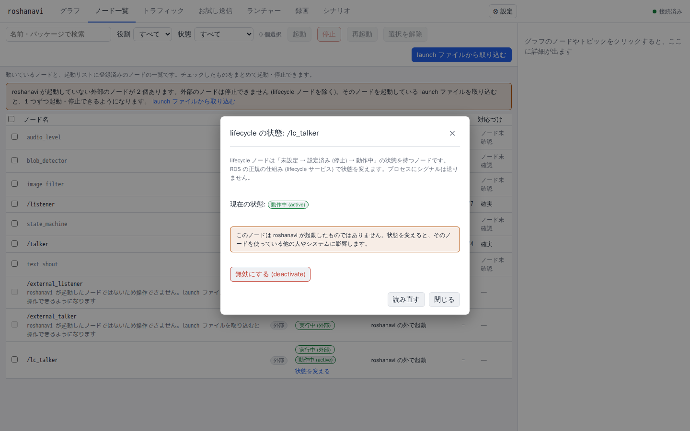

# ランチャーで自分のノードを動かす

自分で作ったノード (ROS では 1 つの処理を受け持つプログラムを「ノード」と呼びます) を、roshanavi の画面から起動・停止・再起動し、ログを見て、ビルドし直すまでの手順です。ターミナルで `ros2 run` と打つ代わりに、ブラウザで同じことができます。

この章は「ランチャー」タブの使い方です。関連する章は次のとおりです。

- いま動いている launch ファイル (複数のノードをまとめて起動するファイル) を、そのまま roshanavi の下で動かしたいとき: [既存の launch ファイルごと roshanavi で動かす](takeover.md)
- 自分のコードを roshanavi のノードにしたいとき: [自分のコードを関数・クラスノードにする](user-code.md)
- Docker のプロジェクトに roshanavi を入れたいとき: [Docker で動いている既存のプロジェクトに入れる](docker-integration.md)

## 1. 自分のパッケージが一覧に出る状態にする

ランチャーが一覧に出すのは、ワークスペース (`src/` とビルド結果 `install/` の入ったフォルダ) にあるパッケージ (ROS のコードを配る単位) です。次の 2 つが必要です。

1. roshanavi が、自分のワークスペースを見ていること。ネイティブで動かすときは、ワークスペースで `source install/setup.bash` した端末から `ros2 run roshanavi app` を起動します ([自分のワークスペースに入れる](install.md))。Docker のときは、clone したフォルダの `workspace/` (コンテナの中では `/ws/src`) に置くか、`docker-compose.yml` で自分の `src` を `/ws/src/<名前>` に渡します。
2. パッケージをビルド (`colcon build`) してあること。未ビルドのパッケージも一覧には「未ビルド」の印つきで出るので、そこからビルドボタンで作れます (4 章)。

自分のパッケージが 1 つも無いと、画面に「ワークスペースに自分のパッケージがありません」と出て、渡し方が案内されます。

## 2. ノードを起動する

1. 「ランチャー」タブを開き、「＋ ノードを起動」を押します。
2. 左の一覧からパッケージを選び、その中の実行ファイル (`ros2 run` で動かすもの) か launch ファイル (`ros2 launch` で動かすもの) を選びます。検索欄でパッケージ名や実行ファイル名を絞り込めます。
   - 一覧は、既定ではワークスペースのパッケージとデモ用のものだけです。ROS 標準のパッケージも見たいときは「ROS 標準パッケージも表示」を押します。
   - 追加したパッケージが出ないときは「パッケージを再検索」を押します。
3. 「起動」を押します。

起動したものは、自動で「起動リスト」に残り、プロジェクトファイル (既定は `<ワークスペース>/roshanavi.yaml`) に自動で保存されます。次に roshanavi を起動したときも、一覧に残っています。

初めて開いたときは、起動リストが空なので、3 ステップの案内と「試しに talker を起動してみる」ボタンが出ます。ROS に付いてくる見本のノード (`talker`) を 1 つ動かして、地図に現れるところまで試せます。

### 詳細設定

「詳細設定」を開くと、次の項目を決められます。ふつうは空のままで構いません。

| 項目 | 何のためか |
|---|---|
| ノード名 | 地図の上のノードと、起動したプロセスを確実に結びつけます。付けると、3 章の「確実 / 推定」が「確実」になります |
| 名前空間 (例: `/robot1`) | ノード名やトピックの前に付く名前の枠。同じノードを 2 つ動かすときに重ならないようにします |
| パラメータ | ノードの設定値の上書き。名前と値の行で、`true` / `false` と数値はその型で渡されます |
| リマップ | ノードの中で決まっているトピック名を、起動時に別の名前へ付け替えます |
| パラメータファイル | 設定値をまとめて書いた YAML ファイル。ワークスペースか data フォルダの中のものだけ選べます |
| 開発中 (自分のノード) | チェックすると、地図で「自分のノード」の色 (緑) になります。外すと「依存ノード」(シアン) です |
| roshanavi の起動時に自動で起動する | 次に roshanavi を起動したとき、自動で動かします |
| 落ちたら自動で再起動する | 異常終了したとき、待ち時間を 1 秒、2 秒、4 秒…と延ばしながら (最大 30 秒) 再起動します。自分で止めたときは再起動しません |

launch ファイルのときは、そのファイルが宣言している引数 (`use_sim:=true` のようなもの) の欄も出ます。

「登録して起動」のほかに「登録のみ」もあります。登録だけしておいて、あとで一覧から起動したいときに使います。

## 3. 止める・再起動する・ログを見る

起動リストの各カードに、次のボタンがあります。

| ボタン | 動き |
|---|---|
| 起動 / 停止 / 再起動 | 起動中ならば「停止」「再起動」、止まっているならば「起動」が押せます |
| ログ | 右にログが開きます |
| 編集 | 起動設定を直します。動いているノードに反映するには、再起動が必要です (カードに「設定を変更しました。反映するには再起動してください。」と出ます) |
| 削除 | 一覧から外します (動いていれば止めます) |

カードの状態の表示は次のとおりです。

| 表示 | 意味 |
|---|---|
| 停止中 | 起動していません |
| 起動中… | 起動して 2 秒以内。ノードが地図に現れた時点で「実行中」に変わります |
| 実行中 | 動いています。稼働時間と再起動した回数も出ます |
| 終了 (コード 0) | ノードが自分で正常に終わりました |
| 異常終了 (コード N) | ノードが自分でエラー終了しました。ログを見ます |
| 設定エラー | 起動設定が正しくありません (例: パッケージが消えた)。理由が出るので、編集して直します |

地図のノードを右クリックしても、停止・再起動・ログなどが選べます。roshanavi が起動したノードだけが対象で、roshanavi の外で動いているノードのボタンは灰色になり、理由が出ます (roshanavi は、自分が起動していないプロセスには何もしません)。

### カードの「ノード」と「確実 / 推定」

カードには、そのプロセスに結びついた地図のノードが並びます。「確実」は、起動時の引数のノード名から結びつけたもの、「推定」は「起動の直後に現れたノードなので、このプロセスのものだろう」という推測です。同時に別のノードが起動すると外れることがあるので、ノード名を付けておくと確実になります。

### ログの見方

- 「最新に追従」: 新しい行が出るたびに末尾へ動きます。読み返したいときは外します。
- 「エラー・警告だけ表示」: エラーの行だけに絞ります。
- 検索欄: 文字列で絞ります。
- 「クリア」: 画面の表示を消します (ノードのログそのものは消えません)。
- 最後の 5000 行まで残ります。起動に使ったコマンドと、終了コードも `system` の行として残るので、「何を実行して、どう終わったか」が分かります。

## 4. ビルドする

コードを直したら、その場でビルドして、動いているノードを再起動できます。

1. 左の一覧で、パッケージの横の「ビルド」を押します (ワークスペースのパッケージだけに出ます)。
2. 「成功したら、そのパッケージの起動中ノードを再起動する」にチェックを付けておくと、ビルドが成功した時点で、そのパッケージのノードが自動で再起動します。
3. 結果が「ビルドに成功しました」「ビルドに失敗しました」と出ます。失敗したときは、最初のエラー行が出て、「ビルドログを見る」で全部を読めます。時間がかかるときは「ビルドを中止」で止められます。

ビルドには `colcon` が必要です (`python3-colcon-common-extensions`。Docker のイメージには入っています)。

新しくビルドしたパッケージに「未 source」の印が付くことがあります。roshanavi から起動するノードには自動で反映されるので、そのまま使えます。ターミナルで自分で `ros2 run` するときだけ、`source install/setup.bash` をやり直してください。

## 5. パラメータを見る・変える

パラメータ (ノードが持っている設定値。周期やしきい値など) は、動いているノードに対して、再起動せずに変えられます。

1. 地図でノードを右クリックし、「パラメータを見る・変更する」を選びます (ノードの右ペインからも開けます)。
2. 変えたい行の値の欄に新しい値を入れ、その行の「変更」を押します。動いているノードにすぐ反映されます (ノードが受け付けた場合)。

見るときのポイントです。

- **並び順**: クラスノード ([関数・クラスノード](user-code.md)) では、クラスの `__init__` の引数を書いた順に並びます。自分のコードの引数の順に見られるので、「あの引数はどこだっけ」と探さなくて済みます。それ以外のノードは名前順です。
- **「ROS の内部のパラメータ」の折りたたみ**: `use_sim_time`、`start_type_description_service`、`qos_overrides.*` のように、ROS がどのノードにも自動で用意するパラメータは、普段は折りたたまれています (個数つき)。開けば同じ表で見られて、変更もできますが、ふつうは触る必要がありません。
- **入力のチェック**: 型 (真偽・整数・小数・文字列・配列) に合わない値は、押す前に理由が出ます。ノードが値を拒否したときも、理由が出ます。
- **読み取り専用・型が決まっていないパラメータ**: ノードが「変更不可」としているもの、型が未設定のものは変えられません。
- **roshanavi の外で動いているノード**: 初めは閲覧のみです。「変更を許可する」を押して確認すると、変えられます。そのノードを使っている他の人やシステムに影響することがあるので、確認を挟んでいます。

変えた値は、そのノードが動いている間だけ有効です。次の起動にも残したいときは、起動設定の「パラメータ」(2 章の詳細設定) に書きます。

## 6. ノード一覧でまとめて操作する

「ノード一覧」タブは、動いているノードと、起動リストに登録してあるノードを 1 つの表にしたものです。

- **探す・絞り込む**: 名前やパッケージで検索できます。役割 (自分 / 依存 / ダミー / 外部) と状態 (動いている / 止まっている / 問題あり) でも絞り込めます。
- **まとめて起動・停止・再起動**: 行にチェックを付けて、上の「起動」「停止」「再起動」を押します。確認のダイアログに、対象のノードが並びます。**選んでいないのに一緒に止まるノード** (同じプロセスや同じ launch ファイルのノード) も書いてあるので、確かめてから「停止する」を押します。状態に合わない操作 (止まっているものの停止など) は「対象外」として理由つきで外されます。
- **グループ**: 1 つの launch ファイルから起動したノードや、1 つのプロセスの中に複数のノードが入っている構成 (composable container など) は、見出しの下にまとまります。「この N 個のノードはまとめて止まります」と書いてあります。止めるときは、全部が一緒に止まります。
- **外部のノード**: roshanavi の外で動いているノードは、チェックボックスが灰色です。「launch ファイルから取り込む」ボタンで、そのノードを起動している launch ファイルを取り込めば、1 つずつ操作できるようになります ([既存の launch ファイルごと roshanavi で動かす](takeover.md))。

### 削除と「元に戻す」

チェックを付けて「削除」を押すと、roshanavi の登録 (起動リスト・入力ノード・変換ノード・関数ノード・クラスノード) から外し、動いていれば止めます。

- **消えるのは、roshanavi の登録と、roshanavi が起動したプロセスだけです。** ソースコード、パッケージ、パラメータファイル、録画は消えません。確認のダイアログにもこう書いてあります。
- 削除した直後の約 10 秒間は「元に戻す」が出ます。登録し直して、動いていたものは起動し直します。
- launch ファイルから引き取ったノードは、取り込み直すとまた現れます。いらないノードは、launch ファイルの側から消してください。
- 外部のノードは削除できません。

## 7. lifecycle ノード

lifecycle ノード (ROS の「状態を持つノード」。未設定 → 停止中 → 動作中という段階を踏んで動かす作りのもの) は、ノード一覧の状態の欄に、いまの状態と「状態を変える」ボタンが出ます。地図の右クリックや右ペインからも開けます。

ダイアログには、いまの状態から選べる操作だけが並びます。

| 操作 | 何が起きるか |
|---|---|
| 設定する (configure) | 設定を読み込み、送受信の準備をします。まだデータは送りません (停止中になります) |
| 有効にする (activate) | 送受信を始めます (動作中になります) |
| 無効にする (deactivate) | 送受信を止めます。プロセスは動いたままで、また有効にできます |
| 設定を破棄する (cleanup) | 設定を捨てて、最初の状態に戻します |

- これらは ROS の正規の仕組み (lifecycle のサービス) で状態を変えるだけで、**プロセスにシグナルは送りません。** そのため、roshanavi が起動していないノードにも使えます。確認のダイアログに、そのことを書いてあります。
- ノード一覧で lifecycle ノードを選んで「起動」を押すと「動作中」まで、「停止」を押すと「停止中」までを、必要な順に進めます。プロセス自体は止まりません。「再起動」は対象外です (無効化と有効化で代わりにします)。
- 元に戻せない「終了 (shutdown)」は、わざと出していません。

## うまくいかないとき

| 症状 | 確かめること |
|---|---|
| 自分のパッケージが一覧に出ない | roshanavi をワークスペースを source した端末から起動したか (Docker なら `src` を渡したか)。ビルドしたか。「パッケージを再検索」を押したか |
| 実行ファイルが一覧に出ない | 未ビルドか、`setup.py` / `CMakeLists.txt` で実行ファイルを登録していません。ビルドして再検索します |
| 「設定エラー」と出る | カードに理由が出ます。多いのは、パッケージが消えた、実行ファイルの名前が変わった、です。編集して選び直します |
| 起動してすぐ「異常終了」になる | 「ログ」を開き、「エラー・警告だけ表示」にします。コマンドと終了コードは `system` の行にあります |
| 起動したのに、地図にノードが出ない | ノードが ROS のノードとして起動していないか、`ROS_DOMAIN_ID` が違います ([困ったときの一覧](troubleshooting.md)) |
| カードの「推定」が外れる | ノード名を付けて起動し直すと「確実」になります |
| 「ビルドに失敗しました」 | 「ビルドログを見る」で最初のエラーを読みます。`colcon` が入っているか、依存が入っているか (`rosdep install`) も確かめます |
| ビルドしたのに、前のコードで動く | 「成功したら…再起動する」を付けたか。付けなかったときは、そのノードを再起動します |
| パラメータの変更が「時間切れ」になる | ノードが応答していません (起動の直後や、マシンが忙しいとき)。少し待って「読み直す」を押します。変更のときは、反映されているかもしれないので、読み直して確かめます |
| 「変更」が押せない | 読み取り専用のパラメータか、型が未設定のパラメータです。外部のノードのときは「変更を許可する」を先に押します |
| roshanavi を強制終了したら、ノードが残った | 次に起動したとき、画面の上に「前回の roshanavi が起動したノードが残っています」と出ます。[既存の launch ファイルごと動かす](takeover.md) の「強制終了されたとき」を見ます |

## 仕組みを知りたい人へ

- ランチャー、プロセスの管理と後始末、プロジェクトファイル、パラメータ、lifecycle、ノード一覧: [design/launcher.md](../design/launcher.md)
- 画面の実装メモ (ランチャータブ、パラメータのダイアログ、ノード一覧): [design/ui.md](../design/ui.md)
- API: [design/api.md](../design/api.md)
- セキュリティ (他人のプロセスには触らない、入力の検証): [design/security.md](../design/security.md)
