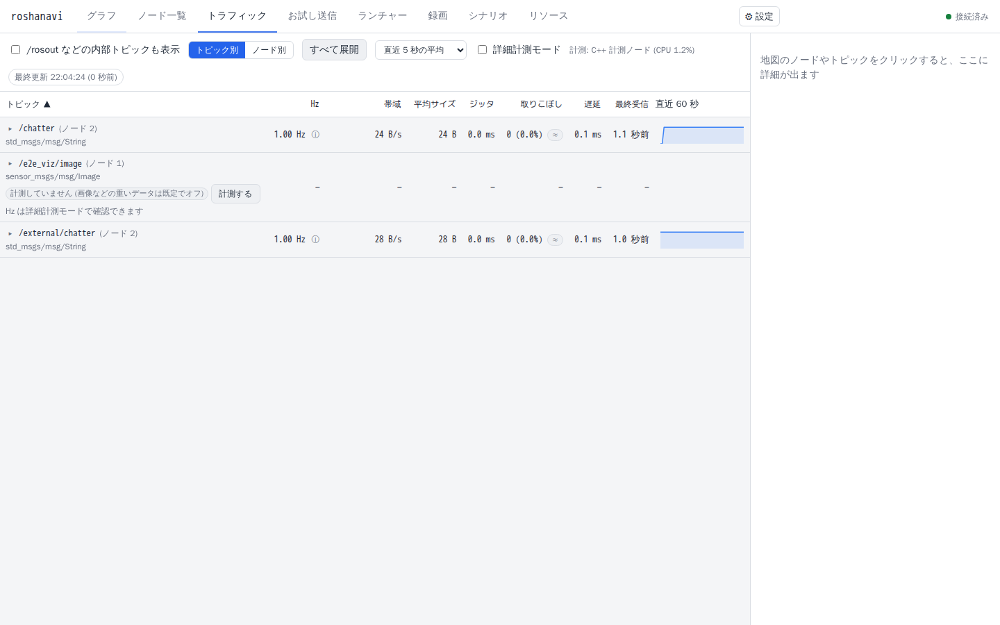
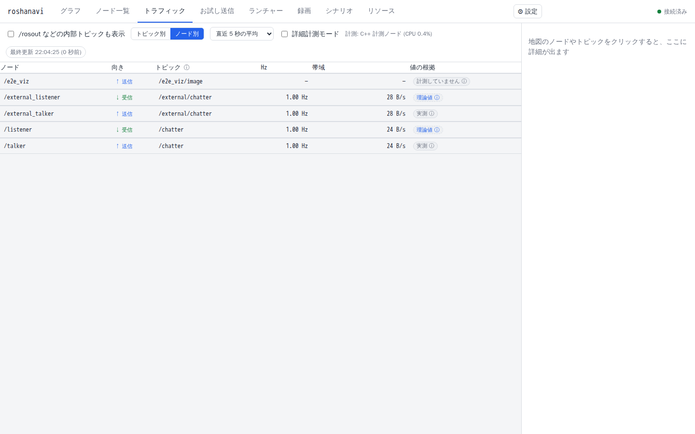
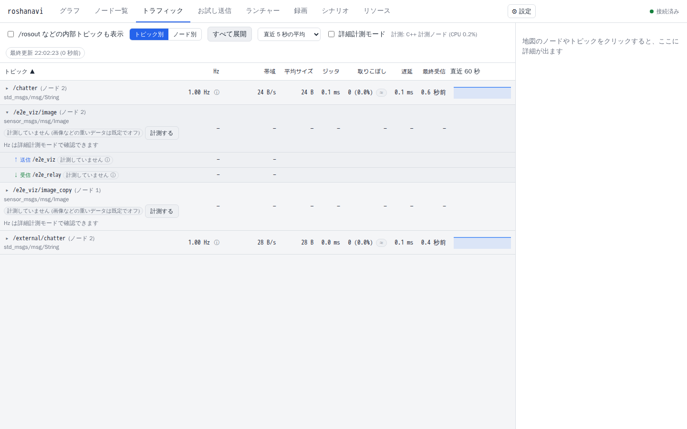
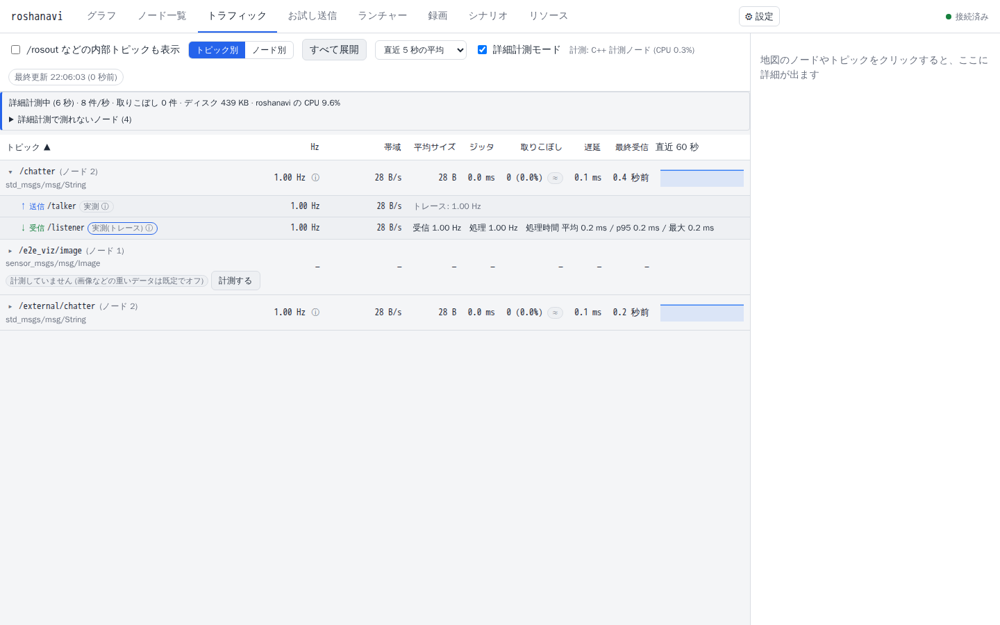

# 測る (トラフィック・詳細計測・リソース)

通信の量や速さ、ノードの処理時間、CPU・メモリの使い方を調べる方法です。「どの数字が、どこまで信用できるか」も合わせて書いています。数字が出ない・おかしいときは、先に末尾の「うまくいかないとき」を見てください。

測れるもの、手段、向いている使い方です。

| 知りたいこと | 使う画面 | 向いているもの |
|---|---|---|
| トピックに、1 秒あたり何回・どれだけのデータが流れているか | トラフィック | 全部のトピック。既定でオン |
| ノードの**中で**実際に受け取った数・処理した数・処理時間 | トラフィック +「詳細計測モード」 | C++ のノード。重い画像のトピックにも負荷が小さい |
| ノードの CPU・メモリ、パソコン全体の状況、メモリリークの疑い | リソース、地図のバッジ | roshanavi と同じパソコンのプロセス |

## 1. トラフィックの表の読み方

トピックごとに 1 行です。列は次のとおりです。

| 列 | 意味 |
|---|---|
| Hz | 1 秒あたりの回数。直近の「計算期間」(1 / 5 / 10 秒から選択) の平均です |
| 帯域 | 1 秒あたりのデータ量 |
| 平均サイズ | 1 回に流れるデータの大きさ |
| ジッタ | 送る間隔のばらつき |
| 取りこぼし | 抜けた回数の割合 (送った番号の欠け) |
| 遅延 | 送ってから届くまでの時間。**送る側と受ける側が同じパソコンのときだけ**意味があります |
| 最終受信 | 最後に受け取った時刻 |
| 直近 60 秒 | 1 秒ごとの Hz の推移 |

- 止まったトピックは、すぐ Hz が 0 になり「停止中」と出ます。
- 数秒に 1 回しか流れない遅いトピックは、計算期間より長く見て計算します。それでも 2 回未満だと「—」になります。
- Hz が出る前の少しの間は「計測中…」と出ます。
- 計測は C++ の計測ノード (`roshanavi_probe`) が行い、**送ったノードごと**に数えます。計測ノードが使えないときは Python で計測し、送信元ごとの値は推定になります (画面に理由が出ます)。

### ノード別の表と「値の根拠」

トピックを開くと、**ノード × トピック × 向き (送る / 受ける)** ごとの行が出ます。それぞれの数字が、どう得られたか (**値の根拠**) も一緒に出ます。

| 根拠 | 意味 | どれくらい信用できるか |
|---|---|---|
| 実測 | 送ったノードごとに、実際に流れたメッセージを数えた値。roshanavi 自身が送った数もこう呼びます | 高い |
| 推定 | トピック全体の実測から、roshanavi が知っている送り手 (入力ノードなど) の分を引いた値 | 目安 |
| パラメータ | 入力ノードに設定した頻度 | 設定どおり |
| 分けられない | 送り手が複数いて、1 つずつに分けられない (トピック全体の値だけ出ます) | — |
| 計測していません | そのトピックを購読していないので値がありません (「受信がない」という意味ではありません)。画像などの重いデータは既定でオフ | — |
| 理論値 | **受け取るノードの中で数えた値ではありません。** QoS が合う送り手が送っている量の合計 = 届くはずの量です。受け手が処理しきれずに捨てた分は含みません | 受け手の実際の値ではない |
| 届いていません | QoS が合う送り手がいない。地図の赤い破線を右クリックすると理由が分かります | — |
| 実測(トレース) | 詳細計測モードで、ノードの中で実際に受け取った数と処理を終えた数を数えた値 | 高い |

受け手の「実際に受け取った数」は、外からは測れません。それを測るのが次の節の詳細計測モードです。

## 2. 重いデータ (画像・点群) は既定でオフ

画像 (`Image`、`CompressedImage`) と点群 (`PointCloud2`、`PointCloud`) のトピックは、roshanavi が受け取るだけでパソコンに負担がかかるので、**既定では計測しません**。表には「**計測していません (画像などの重いデータは既定でオフ)**」と出て、地図では点線です。数字の欄は「0 Hz」ではなく「—」で、「受信なし」「未受信」「分けられない」とは出ません (計測していないだけで、受信がないわけではないからです)。

- 計測したいトピックは、その場の **「計測する」ボタン** を押します (トピックを選んで右側の「このトピックを計測する」でも同じです)。そのトピックだけ購読して、Hz も帯域も測れます。この選択は**プロジェクトに保存**され、roshanavi を再起動しても残ります。
- **詳細計測モード**がオンなら、重いデータの Hz はトレース (送り手が送った回数) から表示されます。購読しないので、データが大きくても測れます。帯域は測れないので「— (詳細計測では帯域は測れません)」と出ます。オフのときは、行に「Hz は詳細計測モードで確認できます」と案内が出ます。
- 起動時に全部計測するなら `--monitor-heavy` を付けます。
- **画像の Hz を、負担をかけずに知りたいときは、詳細計測モード**(次の節)を使います。ノードの中のトレースを数えるだけなので、画像を roshanavi が受け取る必要がありません。
- 負荷の目安は [6. 性能](#6-性能-規模と負荷の限界) の「画像・点群などの重いトピックを計測に入れたとき」にあります。

## 3. 詳細計測モード (トレース)

ROS 2 に組み込まれているトレースの仕組み (LTTng) で、受け取るノードの**中で**、次の 3 つを測ります。ソースコードの変更は要りません。

- 受け取った数 (受信 Hz)
- 処理した数 (処理 Hz)
- 1 回の処理にかかった時間 (平均 / p95 / 最大)

### 使い方

1. トラフィックのツールバーの「詳細計測モード」を ON にします。
2. 負荷の説明のダイアログが出ます。読んで「有効にする」を押します。止めるときは確認なしです。
3. 数秒たつと、測れたノードの行が「実測(トレース)」になり、処理時間が出ます。「受け取っていますが処理が追いついていません: 届く量 10.0 Hz に対して処理 5.00 Hz (1 回の処理に平均 200 ms)」のような指摘も出ます。
4. 測れなかったノードは、画面の下に「詳細計測で測れないノード」として理由つきで並びます。

### かかる負荷 (ダイアログと同じ内容)

| どこに | どれくらい |
|---|---|
| 計測されるノード | 1 メッセージあたり数 µs の CPU。毎秒 1,000 メッセージでも CPU 1 コアの 1% 前後。30 Hz の画像なら無視できます。遅延への影響も数 µs |
| roshanavi | 記録の解析に、毎秒 6,000 件で CPU 1 コアの約 16% (記録が少なくても約 6%)。同じパソコンの他のノードに影響するので、有効な間は roshanavi 自身の CPU 使用率が出ます |
| メモリ | 記録のバッファが CPU 1 個あたり最大 4 MiB (`/dev/shm`) |
| ディスク | 1 秒ごとに区切って、集計したらすぐ消すので 1 MB 前後 |
| 表示 | 1〜2 秒遅れます。バッファがあふれると、記録を捨てて (ノードは止めません) 件数を出します |

### 使える条件と限界

- `lttng-tools` と `python3-bt2` が必要です (Ubuntu: `sudo apt install lttng-tools python3-bt2`)。roshanavi の Docker イメージには入っています。無いと、スイッチは押せなくなり、理由と入れ方が出ます。
- Docker では共有メモリが要ります。compose に `shm_size: 512m` を付けてください (小さいと、何も記録されません)。足りないときは「共有メモリの空きが足りない」と出ます。
- 測れるのは**roshanavi と同じパソコン**(Docker では同じコンテナ) で、**roshanavi より後に起動した**ノードです。前から動いているノードは、再起動すると測れます。別のコンテナのノードは「記録がない」と出ます。
- **Python のノードは、受け取った数だけ**測れます (処理した数・処理時間は出ません)。C++ のノードは 3 つとも測れます。
- ノードの起動直後の 1〜2 秒は、記録を捨てることがあります。
- Fast DDS で確認しています。他の RMW では、受信・送信の数が出ないことがあります。

## 4. リソースタブと地図のバッジ

- 地図のノードに `CPU 12% · 45 MB` のようなバッジが付きます。CPU が 1 コアの 40% 以上で黄、80% 以上で赤の縁になります。メモリリークの疑いは警告色です。
- 「リソース」タブには、パソコン全体 (CPU・メモリ・ディスク・ネットワーク・GPU)、プロセスの表 (ROS のノード / roshanavi 自身 / その他)、外部との接続先が出ます。ノード名を押すと地図でそのノードが選ばれます。
- ノードを選ぶと右側に、CPU とメモリの直近 5 分の推移、開いているファイル、スレッドなどが出ます。
- **見えるのは、roshanavi が動いているパソコンのプロセスだけ**です。別のパソコンやコンテナの外のノードは見えません。
- 診断パネルには、メモリリークの疑いのほか、ディスクの空きが少ない、UDP の受信バッファがあふれている、が出ます。

次の 5. が、メモリリークを見つける仕組みと、その精度・限界です。

## 5. リソース監視とメモリリークの検出

ノードごとの CPU・メモリを地図にバッジで出し、「リソース」タブで PC 全体 (CPU・メモリ・ディスク・ネットワーク・GPU) とプロセス一覧を見られます。roshanavi 自身のプロセスは「roshanavi 自身」という別枠に並びます。**監視できるのは roshanavi が動いている PC のプロセスだけです。**

メモリが増え続けるプロセスは、リーク検出が見つけます。「リーク」を **一定の速さで、減速せずに、長く増え続けるメモリ** と定義し、1 分ごとの中央値から、10 分・1 時間・6 時間の 3 つの時間スケールで同時に判定します。

- 診断パネルに出るのは **リークの疑い**: 「`/detector` のメモリが毎分 0.3 MB で 2 時間増え続けています (減速なし)」のように、速さと継続時間を数値で出します。
- **様子見 (増加中・収束しつつある)** は、リソースタブにだけ出ます: 一度だけの増加の直後や、バッファが埋まって頭打ちになる途中です。
- 誤検出しないパターン (単体テストで確認): 一度だけの段差、頭打ち (バッファが埋まる)、一瞬のスパイク、揺れだけで増えていない場合 (24 時間の実行 400 回で 0 回)。

**検出できる速さと、検出までの時間** (合成データで実際に検出できた最小の速さ。かっこは検出までの時間の中央値 / 最大):

| 時間スケール | 判定できる最短時間 | 揺れが小さい (±1 MB) | 揺れがふつう (±6 MB) | 揺れが大きい (±20 MB) |
|---|---|---|---|---|
| 10 分 | 17 分 | 0.5 MB/分 (17 分 / 17 分) | 1 MB/分 (173 分 / 425 分) | 3 MB/分 (173 分 / 425 分) |
| 1 時間 | 59 分 | 0.07 MB/分 (76 分 / 261 分) | 0.3 MB/分 (106 分 / 416 分) | 1 MB/分 (105 分 / 347 分) |
| 6 時間 | 347 分 (約 6 時間) | 0.01 MB/分 (437 分 / 637 分) | 0.05 MB/分 (347 分 / 381 分) | 0.15 MB/分 (347 分 / 381 分) |

最小の速さ ≈ メモリの自然な揺れ ÷ 観察時間です。遅いリークほど検出は遅くなりますが、見逃しにくくなります (3 MB/分なら 17 分、揺れがふつうのプロセスの 0.1 MB/分は約 6 時間で検出)。測り方と数字の根拠は [../design/resources.md](../design/resources.md#メモリリークの見せ方-leakpy-45) にあります。

**限界**
- 見ているのは RSS (実際に使っている物理メモリ) です。言語のアロケータが解放したメモリを OS に返さないと、リークでなくても減りません。
- 揺れに埋もれる小さな漏れは、観察時間が短いうちは検出できません (表のとおり)。ゆっくり埋まるバッファは、最初の 20〜40 分ほどリークの疑いに見えることがあります (埋まれば消えます)。
- **どのコードが漏らしているかは分かりません**。原因の特定は各言語のプロファイラ (Python の tracemalloc / memray、C++ の valgrind / heaptrack など) を使ってください。
- 同じ PC のプロセスだけが対象です (他の PC や別コンテナのノードは見えません)。

## 6. 性能 (規模と負荷の限界)
中継パイプラインのサンプルで実測した、この PC (Docker・24 コア・ほかの処理も動いている共用機) での目安です。詳しい表と測り方は [../design/measurement.md](../design/measurement.md#規模と負荷の限界-51)。

- **ノード数**: 80 ノード (128 トピック) まで、地図の更新は 1 秒周期のまま (フレームの遅れ p95 ≲ 100 ms)。200 ノード (360 トピック) では 1 フレームが約 1.5 MB になり、更新が 1.4〜1.6 秒おきに遅れ、server が 1 コアの 5〜7 割を使います。
- **通信量**: C++ 計測ノードの CPU は流量に比例します。20 ノードで全トピック合計 約 1.6 万通/秒、または 1 MiB×30 Hz の 4 本の列 (約 500 MB/秒) で 1 コア近く。roshanavi の server は 20 ノードで 12% 以下、80 ノードで 26〜32%。
- **先に詰まるのは ROS 側**: 20 ノードで 送信元 1 つあたり 300 Hz まで、メッセージ 1 MiB まで欠落なし。composable container (1 スレッド) は処理が重い段の合計が 1 コア分を超えると崩れます (`component_container_mt` で解消)。1 ノード 1 プロセスで 200 ノードは、この PC の Fast DDS では発見が成立せず動きませんでした (container なら動く)。
- **画像・点群など重いトピックを計測に入れたとき** ([詳細](../design/measurement.md#重いデータの計測の限界-51)): probe の CPU は「毎秒の件数」と「毎秒の合計バイト数」の両方で決まり、**メッセージが約 85 KB より大きいとバイト数 (コピー) が、小さいと件数が効きます** (目安は 1 件あたり約 0.12 ms + 1 MB あたり約 1.4 ms)。**同じ PC で Fast DDS の共有メモリが使えれば**、1 トピック約 150 MB/秒 (1080p × 30 Hz、100 万点の点群 × 10 Hz) まで、計測を入れても計測される側の遅延は 1〜3 ms しか増えません。共有メモリが使えず UDP だけの構成では大きいメッセージの負担が約 2 倍になるので、目安は約 100 MB/秒まで。4K × 30 Hz (約 750 MB/秒) などはどちらでも壊れる (購読側が 2〜6 割取りこぼす) ので、計測を切るか詳細計測モードを使ってください。
- **詳細計測モード (トレース)** を入れても取りこぼしは出ませんでした。server + トレースの CPU は 20 ノードで 23〜115%。
## うまくいかないとき

| 症状 | 確かめること |
|---|---|
| 画像・点群が「計測していません」と出て Hz が見えない | 既定の動きです。行の「計測する」を押すか、詳細計測モードを使います (Hz だけなら詳細計測モードが軽い) |
| Hz が「—」や「計測中…」のまま | 流れるのが遅い (数秒に 1 回以下) と、少ししたあとでも「—」になります。止まっているなら 0 / 「停止中」です |
| 送ったノードごとの値が「推定」になる | 計測ノードが使えていません。表の上の説明に理由が出ます (ビルドされていない、異常終了、`--probe off` など) |
| 受け手の Hz が「理論値」のまま | 詳細計測モードがオフ、または測れないノードです。理由は「詳細計測で測れないノード」に出ます |
| 詳細計測モードのスイッチが押せない | `lttng-tools` と `python3-bt2` を入れる。Docker は `shm_size: 512m` |
| 詳細計測モードで取りこぼしの件数が増える | バッファがあふれています。流量が多すぎます。対象のトピックを減らします |
| 取りこぼしが出る | 数の欠け (送った番号の欠番) です。受け手の処理が遅くて捨てられたか、ネットワークの問題です。詳細計測モードで「処理が追いついていません」が出ないか見ます |
| CPU が高いのに処理は少ない | 空回りしているかもしれません。[design/measurement.md](../design/measurement.md#cpu-が高い-multithreadedexecutor-の空回り) に、`MultiThreadedExecutor` の場合の見つけ方と直し方があります |
| ノードの CPU・メモリが出ない | 別のパソコン / 別のコンテナのノードです。roshanavi と同じ場所で動いている必要があります ([動いているシステムを見るだけ](observe.md)) |

## 仕組みを知りたい人へ

- 計測ノード、詳細計測モードの仕組み、規模と負荷の全結果、重いデータの限界の全表: [design/measurement.md](../design/measurement.md)
- トラフィックの数字の意味、値の根拠: [design/map-and-traffic.md](../design/map-and-traffic.md)
- リソース監視、メモリリーク検出の手順と、検出できる速さの全表: [design/resources.md](../design/resources.md)
