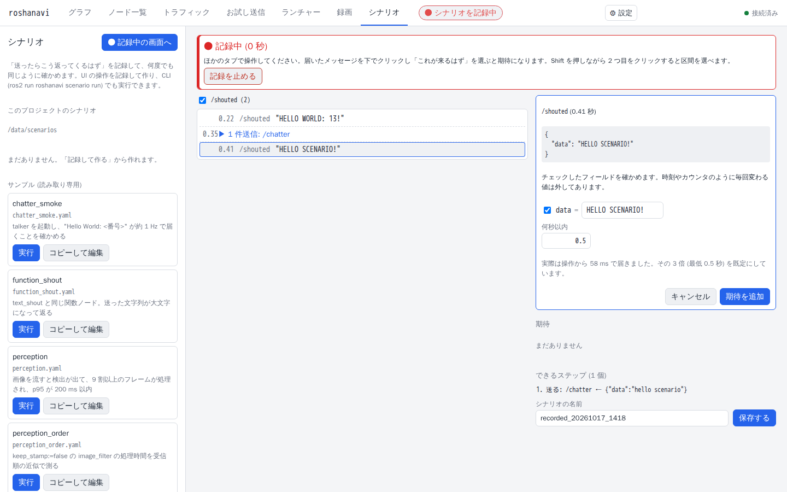
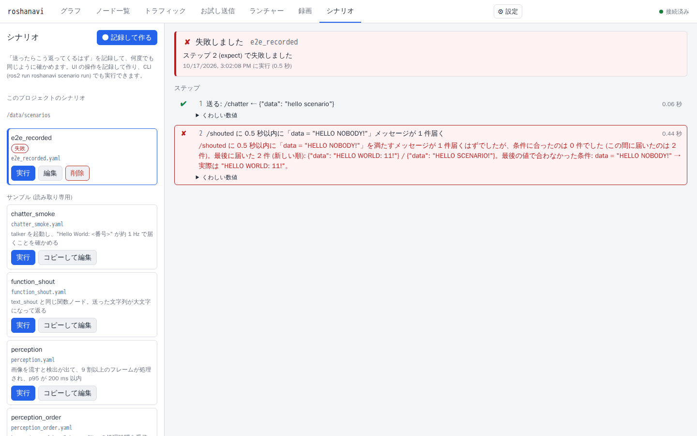

# シナリオで確かめる・テストに組み込む

「この入力を送ったら、○秒以内にこう出るはず」を**画面の操作を記録して**作り、何度でも同じように自動で確かめる方法です。書いたものは YAML のファイルとして保存されるので、コマンドラインや CI (自動テスト) からも実行できます。YAML は手で書かなくても作れます。

- 対象はトピックです (サービス・アクションは今後対応します)。
- 確かめられるもの: 出力の中身、出力の頻度 (Hz)、入力に対する出力の割合、処理時間、CPU・メモリ、メモリが増え続けないこと。

## 1. 記録して作る

画面上の案内つきで通したいときは、⚙ 設定 →「チュートリアル」→「シナリオを記録する」です。以下は同じ内容です。

1. 「シナリオ」タブを開き、「記録して作る」を押します。
2. **見張るトピック**(確かめたい出力。最大 8 つ)を選んで、記録を始めます。画面の上に「● シナリオを記録中」と出ます。
3. **いつもの操作をします。** どのタブでの操作も記録されます。お試し送信で値を送る、ランチャーでノードを起動・停止・再起動する、などです。操作の間隔は「待つ」になります。
4. 見張っているトピックに出てきたデータが、タイムラインに並びます。確かめたいものを**クリック**して「これが来るはず」を選ぶと、「届くはず」という判定ができます。
   - 比べる項目は自動で選ばれます。数は近い値 (許す差 1%) で、番号だけ違う文字列 (`Hello World: 12` と `…: 13`) は「番号は何でもよい」形になります。時刻やカウンタのように毎回変わる項目は、理由つきで外れます (チェックで戻せます)。
   - 待つ時間は、実際の応答時間の 3 倍 (最低 0.5 秒) です。
5. **Shift を押しながらクリック**で時間の幅を選ぶと、次の判定も作れます。
   - 「ずっと条件どおり」(always) / 「来ないはず」(never)
   - 頻度が範囲に入っている (Hz)
   - 入力に対する出力の割合
   - 処理時間 (入力から出力までの p50 / p95 / 最大)
   
   しきい値は、記録中に測った値から提案されます。
6. 「記録を止める」→ 名前を付けて**保存**します。保存すると「シナリオ」の一覧に出ます。



## 2. 実行する・編集する

- 一覧から選んで「実行」を押すと、ステップごとに ✔ / ✘ が出ます。
- 「編集」でフォームから直せます (ステップの順番、条件の追加・削除、値や許す差)。詳細設定モードでは YAML を直接直せます。
- 「サンプル」は読み取り専用です。「コピーして編集」でプロジェクトにコピーして使います。
- 削除は確認が出ます。

保存場所は、プロジェクトのファイル (`roshanavi.yaml`) の隣の `scenarios/` フォルダです。Docker の例なら `.roshanavi/scenarios/` です。このファイルは git に入れて構いません。

### 失敗したときの説明

失敗したステップには、「何が来て、何が足りなかったか」が平易な文で出ます。

- 受け取った件数、条件に合った件数、最後に届いた値 (新しい順に最大 3 件)
- 最後の値で合わなかった条件と、実際の値
- 「来ないはず」「ずっと条件どおり」を破ったときは、破った値と時刻
- **原因の候補**: 判定するトピックに送り手がいない (似た名前のトピックがあれば教えます)、送ったトピックを誰も受け取っていない、QoS が合わない組、同じトピックに複数のメッセージ型がある、など

最初に失敗したステップで止まり、残りは「未実行」になります。実行の後片付け (送信の停止、起動したノードの停止) は、成功・失敗・中止のどの場合も必ず行われます。



## 3. ステップの種類

YAML を直接見る・書くときの早見表です。詳しい書き方は [design/scenarios.md](../design/scenarios.md)。

| ステップ | 意味 |
|---|---|
| `send` | 1 件送る |
| `start` / `stop` | 周期送信・ファイル・メディアを裏で始める / 止める。プロジェクトの起動設定 (ノード) を起動 / 停止することもできる |
| `play` | 録画した bag を再生する |
| `wait` | 指定の秒数待つ |
| `call` | クラスノードの操作メソッド (引数なし) を呼ぶ。例: `call: {node: /scenario_average, method: reset}` |
| `expect` | `within` 秒以内に、条件 (`where`) を満たすメッセージが届く |
| `always` / `never` | 指定の秒数のあいだ、すべて条件を満たす / 一度も満たさない |
| `rate` | 頻度が範囲に入る |
| `throughput` | 入力の件数に対する出力の件数の割合 |
| `latency` | 入力から出力までの処理時間の上限 |
| `resources` | ノードの CPU の平均と、メモリ (RSS) の最大 |
| `mem_growth` | ノードのメモリの増え方 (MB/分) の上限 |

`guards` はシナリオ全体を通して見張る条件、`setup` はステップの前に起動するノード (`run` / `launch` / 関数・クラス・変換・入力ノード / プロジェクトの起動設定) です。

### リソースのチェック

`resources` と `mem_growth` は、トピックではなく**ノードのプロセス**を測ります。

```yaml
steps:
  - wait: {seconds: 3.0, label: 起動直後の負荷が落ち着くまで待つ}
  # CPU は 5 秒間の平均 (1 コア = 100%)、メモリは最大値
  - resources: {node: /busy_cpu_target, cpu_max: 40, mem_max_mb: 300, for: 5.0}
  # メモリの増え方 (MB/分)。10 秒以上必要
  - mem_growth: {node: /busy_cpu_target, max_mb_per_min: 5, for: 10.0}
```

- ノードは、シナリオを実行している PC の、同じユーザーのプロセスとして見つかる必要があります。見つからないと「プロセスが見つかりませんでした」で失敗します。
- シナリオ自身が起動したプロセスなら確実に特定でき、それ以外は結果に「推定」と書かれます。
- 起動直後の確保を除くには、前に `wait` を置きます。
- 実例は `examples/scenarios/busy_cpu.yaml` です。

## 4. コマンドラインと CI

```bash
ros2 run roshanavi scenario run scenarios/ --junit results.xml
```

- ファイル 1 つも、フォルダ (中の `*.yaml` を名前順にすべて) も指定できます。
- `--junit 結果.xml` で JUnit 形式、`--json 結果.json` で JSON の結果を出せます。多くの CI がそのまま読めます。
- 終了コードは、すべて成功なら 0、どれか失敗なら 1、指定の誤り (ファイルが無いなど) なら 2 です。
- Docker なら、たとえば `docker compose run --rm <サービス> ros2 run roshanavi scenario run /data/scenarios/ --junit /data/results.xml` のように実行します。
- ノードの場所などは `--workspace`、`--data-dir`、`--project` で指定します (既定は環境変数 `ROSHANAVI_WORKSPACE`、`ROSHANAVI_DATA_DIR` か、いまのフォルダ)。

### launch_pytest から呼ぶ

すでに `launch_pytest` で ROS のテストを書いているなら、ノードの起動は今までどおり launch に任せて、判定だけシナリオにできます。

```python
from roshanavi.scenario import run_scenario

@pytest.mark.launch(fixture=state_machine)
def test_state_machine_scenario():
    result = run_scenario(SCENARIO)          # SCENARIO はシナリオ YAML のパス
    assert result.passed, '\n'.join(result.failures())
```

ノードを起動する launch と、送って判定するシナリオ (`send` → `expect`) の完全な例が `examples/launch_pytest/` にあります。

- [test_state_machine_launch.py](https://github.com/shimejilib/roshanavi/blob/main/examples/launch_pytest/test_state_machine_launch.py)
- [state_machine_scenario.yaml](https://github.com/shimejilib/roshanavi/blob/main/examples/launch_pytest/state_machine_scenario.yaml)

## うまくいかないとき

| 症状 | 確かめること |
|---|---|
| 「届くはず」が失敗する | 失敗の説明の「原因の候補」を読む。トピック名の打ち間違い、送り先を誰も受け取っていない、QoS の不一致が多いです |
| 毎回ではなく、ときどき失敗する | 待つ時間 (`within`) が短すぎないか。マシンが忙しいと応答が遅れます。実測の 3 倍が目安ですが、余裕を持たせます |
| 頻度の判定が不安定 | 見る時間 (`for`) を長くする。2 件未満だと「測れない」になります |
| 処理時間が「1 組もできない」 | 出力が入力の時刻 (`header.stamp`) を引き継いでいないかもしれません。対応づけを `match: order` (受信順の近似) にします |
| `resources` が「…のプロセスが見つかりませんでした」 | ノードが別のコンテナや別の PC にいないか。シナリオの実行と同じ環境で動いている必要があります |
| 「記録して作る」で、記録中に他の人の操作も入る | 記録は同じ roshanavi を使う全員の操作を拾います。1 人で使うか、あとでステップを削除します |
| 重い画像のトピックで割合が低く出る | 判定する側の受信が追いつかないことがあります。頻度が高い画像のトピックは避けるか、頻度を下げます |
| CI でノードが見つからない | `ROS_DOMAIN_ID` が他のテストと重なっていないか。ワークスペースを source しているか |

## 仕組みを知りたい人へ

- ファイル形式、判定のルール、記録モードの仕様: [design/scenarios.md](../design/scenarios.md)
- リソース判定の仕組み: [design/resources.md](../design/resources.md#シナリオ連携)
- テスト項目: [project/testing.md](../project/testing.md)
