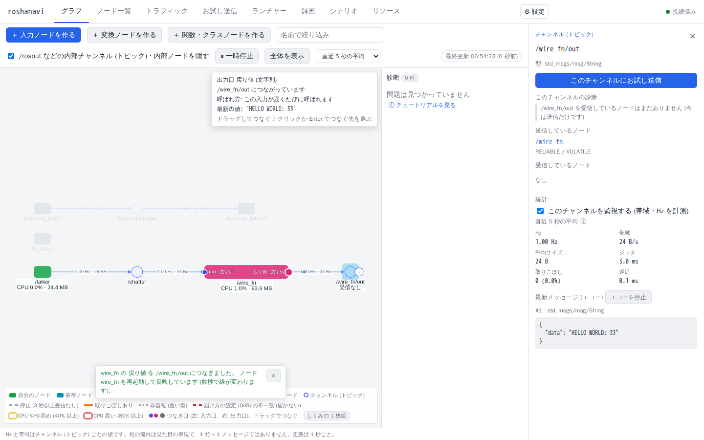
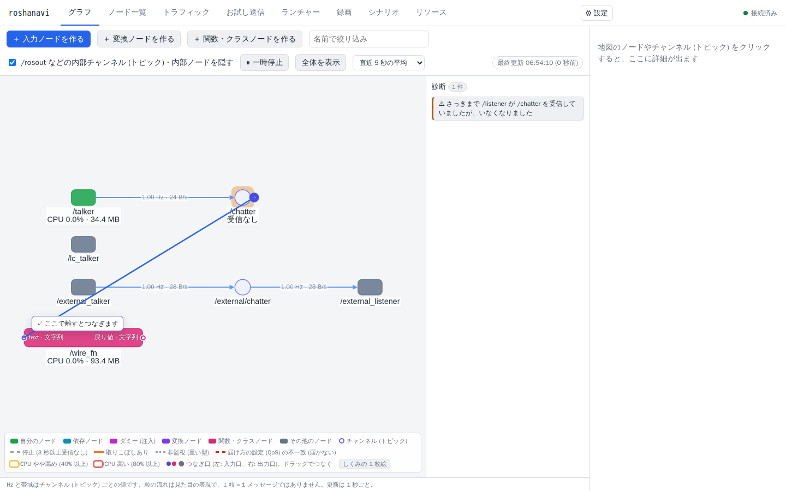
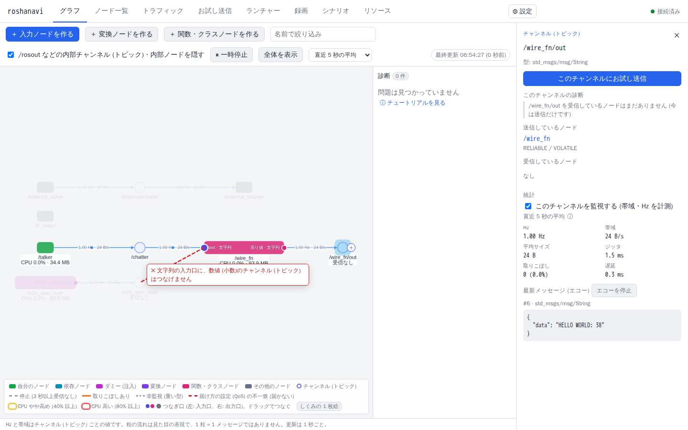
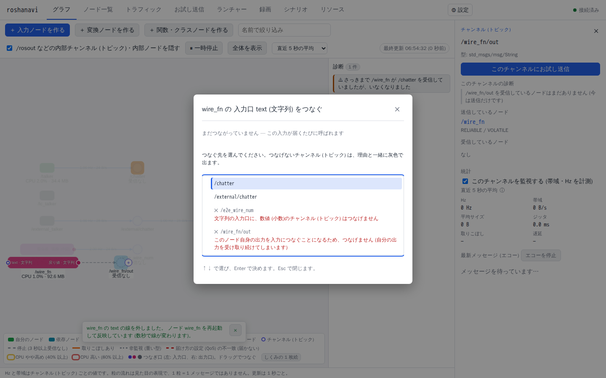

# 線でつないで作る

チャンネル (トピック) の名前を打たずに、地図の上で線を引いて、自分の関数やクラスをノードとしてつなぐ方法です。知っておくことは「ノードはチャンネルに送り、チャンネルを購読して受け取る」だけです (地図の凡例の「しくみの 1 枚絵」で確かめられます)。設計の詳しい説明は [design/wiring.md](../design/wiring.md)。

## 1. ノードを置く
1. 地図の上の「＋ 関数・クラスノードを作る」を押し、関数 (またはクラス) を選びます。まだコードが無ければ「コードの場所」の「ひな形を作る」で作れます ([user-code.md](user-code.md))。
2. 「チャンネルは地図で線を引いてつなぐ (ここは空にする)」を押してから「作成して起動」。
3. 地図にノードが現れ、左に **入力口** (関数の引数)、右に **出力口** (戻り値) が小さな丸で出ます。丸の横の `text · 文字列` は、引数の名前とデータの種類です。クラスは処理メソッドごとに口が出て、`reset` のような操作メソッドはノードの上のボタンになります。

作成画面の「呼ばれ方」には、いつ関数が呼ばれるかが文と図で出ます (「この入力が届くたびに呼ばれます」「10 Hz で呼ばれます」など)。入力が 2 つ以上なら、「どれかが届いたとき」か「a が届いたときだけ」を図の下で切り替えられます。

## 2. 線を引く
- **受け取る**: チャンネル (楕円) にマウスを乗せると右に「＋」が出ます。そこから入力口までドラッグします。入力口からチャンネルへ引いても同じです。
- **送る**: 出力口から、空いているところへドラッグすると新しいチャンネルができます。名前は `/<ノード名>/out` が入っているので、そのまま「作ってつなぐ」か、直してから押します。既存のチャンネルへ引くと、そこへ送ります。別のノードの入力口へ引くと、間にチャンネルを作ってつなぎます。
- つなぐと、ノードが数秒で再起動して動き始めます (クラスノードは状態が最初からになります)。出力口にマウスを乗せると、最新の値が見えます。

## 3. つなげない組み合わせ
データの種類が合わないと、引いている間に赤い破線と理由が出て、離してもつながりません。

| 組み合わせ | どうなるか |
|---|---|
| 同じ種類 (文字列 → 文字列 など) | つながる |
| 整数 → 小数 | つながる (「整数を小数として渡します」) |
| 文字列 ↔ JSON | つながる (JSON でない文字列は捨てて、エラーに数えます) |
| 小数 → 整数 | つながらない (小数点以下が失われるため) |
| ほかの違う種類 (画像 → 文字列 など) | つながらない |

自分で書いた ROS ノード (ランチャーで起動したもの、roshanavi の外で動いているもの) には口がありません。どのチャンネルを使うかがコードの中で決まっているからです。そのノードのチャンネル (楕円) に線を引いてください。

## 4. 外す・つなぎ替える
- 線をクリックすると「線を外す (Delete)」「つなぎ替える…」が出ます。
- つなぎ口からもう一度引くと、つなぎ替えになります。
- 変換ノードと入力ノードの口は外せません (つなぎ替えだけ)。

## 5. キーボードで
1. Tab でつなぎ口を選びます (読み上げ: 「wire_fn 入力口 text (文字列)、まだつながっていません …」)。
2. Enter で、つなぐ先の一覧が開きます。↑↓ で選びます。つなげないチャンネルは灰色で、理由が書いてあります。
3. Enter で確認、もう一度 Enter でつなぎます。Esc で戻ります。Delete を押すと、選んでいる口の線を外します。

## 6. 保存先
線は、そのノードの設定 (プロジェクトファイルの `functions:` / `classes:` など) のチャンネル名として保存されます。新しいファイルはできません。設定画面 (右クリック「関数ノードの設定を変更」) を開くと、地図でつないだチャンネル名が入っています。つながっていない口があるノードは、「ROS ノードのコードとして書き出す」ができません (全部つないでから書き出します)。
